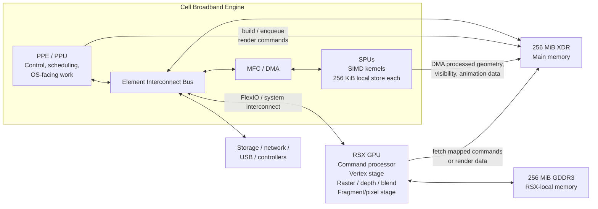

# Legal PlayStation 3 Development: Architecture, Toolchains, Graphics Engine Design, and Distribution

## Executive summary

The PlayStation 3 is an unusually asymmetric machine: a 3.2 GHz-era Cell Broadband Engine couples one general-purpose PowerPC Processing Element (PPE) to multiple Synergistic Processing Elements (SPEs), each with its own 256 KiB explicitly managed local store and DMA engine; graphics are handled by Sony/NVIDIA’s RSX, a non-unified, GeForce-7-generation GPU with separate programmable vertex and fragment/pixel stages. The console has two physically distinct 256 MiB memory pools—XDR main memory associated with Cell and GDDR3 video memory associated with RSX—rather than the unified memory model common on later consoles. IBM’s public Cell documentation describes the processor as one PPE plus eight SPEs connected by a memory-coherent Element Interconnect Bus, while Sony’s public PS3 specifications identify 256 MiB XDR main RAM and 256 MiB GDDR3 VRAM. citeturn28view0turn22search1

For **authorised native development and commercial distribution on unmodified retail PS3 hardware, there is no publicly available, licence-free Sony SDK**. Sony explicitly stated that PS3 developers obtained its SDK by signing a licence agreement and purchasing development-tool products; its historical toolchain included the SNC PPU compiler, Debugging Station/Reference Tool hardware, and PhyreEngine. The present PlayStation Partners portal remains Sony’s official developer entry point, but there is no public indication that Sony is accepting new PS3 commercial projects in 2026, so prospective commercial developers would need to ask SIE directly rather than assume historical PS3 tools remain obtainable. citeturn23view3turn31view0

There is, however, a meaningful **open-source development path for research and homebrew**. PSL1GHT is an MIT-licensed open-source GameOS homebrew SDK; ps3toolchain supplies the PPU/SPU compiler toolchains, patched newlib, binutils and associated utilities. PSL1GHT currently builds `.elf` and `.self` files and can build `.pkg` targets where a project defines one. Its own maintainers explicitly describe this as a *homebrew* SDK—not as a substitute for Sony's licensed retail-development programme. citeturn30search3turn0search2turn0search3

A second fully legitimate historical path is **Cell development under Linux**. IBM published a public Cell SDK with PPE/SPE compilers and libraries, `ppu-gdb`/`spu-gdb`, and a full-system Cell simulator. This was suitable for Cell/Linux work, including the PS3's historical OtherOS environment, but it was not a native GameOS retail-title SDK. Sony removed the official “Install Other OS” feature in firmware 3.21 in 2010, so OtherOS should now be treated as a historical platform rather than a supported contemporary PS3 deployment route. citeturn28view0turn28view1turn23view6

For a new legal PS3-oriented engine project in 2026, the most defensible workflow is therefore:

| Objective | Recommended route | Legal/technical status |
|---|---|---|
| Study Cell/SPU programming | IBM public Cell documentation, simulator material and open toolchains | Public documentation; historical tooling. citeturn28view0turn28view1 |
| Develop open-source PS3 homebrew | ps3dev + ps3toolchain + PSL1GHT | Open-source SDK/toolchain; targets homebrew rather than authorised stock-retail distribution. citeturn30search3turn0search2 |
| Develop/test without modifying a console | RPCS3, using legally obtained software/assets | Practical emulator route; RPCS3 instructs users to use legal copies and dump their own games. citeturn20search3turn20search11 |
| Ship a commercially authorised stock-retail PS3 title | Sony/SIE licence and official toolchain | Historically required a Sony licence and proprietary tools; availability today must be confirmed with SIE. citeturn23view3turn31view0 |
| Use official OtherOS/Linux | Not a current route | Sony removed official OtherOS installation in system software 3.21. citeturn23view6 |

The architecture strongly rewards an engine built around **large, predictable batches and asynchronous pipelines**. The PPE should orchestrate the application rather than perform all numerical work; suitable SPU jobs include animation skinning, visibility/culling, geometry or particle preparation, decompression, audio/DSP and streaming transforms. SPU jobs should DMA one block while computing another. The RSX should receive large batches through command buffers, keep frequently reused render targets/textures in local GDDR3, and minimise CPU↔GPU synchronisation. These recommendations follow directly from Cell's explicitly managed local stores and asynchronous DMA model and from NVIDIA's documented characteristics of the GeForce-7-generation graphics architecture. citeturn28view0turn27view0turn27view2

The report deliberately does **not** include Sony cryptographic material, leaked SDK interfaces, retail signing keys, jailbreak/exploit procedures, or methods for bypassing PS3 authentication. Those are unnecessary for understanding or implementing the architecture and introduce substantial licence and anti-circumvention risk. Sony's current software terms prohibit bypassing encryption/security/authentication mechanisms for covered software, and U.S. copyright law separately regulates circumvention and trafficking in circumvention technology, subject to limited exceptions such as qualifying interoperability research. citeturn31view1turn31view2

## Platform architecture

### Cell Broadband Engine

IBM's public Cell programming tutorial is the strongest freely available primary technical source for the CPU. It describes the first-generation Cell Broadband Engine as a nine-processor system: one PPE and eight SPEs, all connected to main storage and I/O by the Element Interconnect Bus. The PPE is a dual-hardware-thread, 64-bit PowerPC processor with the PowerPC Vector/SIMD Multimedia Extension; the SPEs are specialised SIMD processors designed around explicit local storage and DMA rather than conventional transparent data caches. citeturn28view0

The distinction matters more than the nominal processor count:

| Element | Architectural role | Engine implication |
|---|---|---|
| PPE / PPU | 64-bit PowerPC control processor; dual-threaded; runs the OS/control plane. citeturn28view0 | Main loop, resource management, job scheduling, rendering orchestration, serial/branch-heavy code. |
| SPE / SPU | SIMD compute processor with 128 × 128-bit registers and 256 KiB local store. citeturn5view0turn28view0 | Small compute kernels, streaming algorithms, animation, culling, decompression, DSP. |
| MFC | Memory Flow Controller associated with the SPE, providing asynchronous DMA. citeturn5view0turn28view0 | Move blocks between main storage and local store while the SPU executes. |
| EIB | Four-ring, high-bandwidth, memory-coherent on-chip interconnect. IBM documents 96 bytes/cycle internal bandwidth and more than 100 outstanding SPE DMA requests. citeturn28view0 | Enables many simultaneous transfers; performance depends on avoiding unnecessary contention. |
| MIC | Interface between EIB and XDR main storage. citeturn28view0 | Main-memory traffic ultimately converges here. |
| BEI/FlexIO | External I/O side of Cell. citeturn28view0 | In the PS3, provides the route towards RSX and other system I/O. |

The SPE local store is particularly important. It is **not a hardware-managed L1/L2-style data cache**. Code and data required by an SPU kernel have to fit into its 256 KiB local store, and data is normally transferred between local store and the process's effective address space through asynchronous DMA. IBM explicitly recommends exposing local storage and DMA to software and notes that overlapping data/code movement with execution is central to overcoming memory latency. citeturn28view0

Cell's main-storage domain is coherent at the architectural level, but this should not be misunderstood to imply transparent coherency between an SPU's local store and main memory. The programmer has to issue and complete the relevant DMA operation before assuming that a newly produced block is available at its destination. That distinction is the basis for most good PS3 SPU software architecture. citeturn28view0

In conventional PS3 software, both PPU and SPU data should be treated as **big-endian**. IBM material describes Cell/B.E. as a big-endian architecture, and contemporary PS3 architectural analyses likewise document the practical software environment as big-endian. Portable engine code should therefore put explicit byte-order conversion in asset/network/serialisation layers rather than assuming host byte order, because most modern development hosts are little-endian. citeturn21search1turn21search13

A useful conceptual data-flow model is:



This is a programming-model diagram rather than a literal electrical schematic. The Cell-side structure follows IBM's architectural block diagram, while Sony documents the PS3's two 256 MiB memory pools; PSL1GHT's public RSX structures distinguish resources residing in “RSX” and “Cell” locations, which is useful evidence for the practical dual-memory programming model. citeturn28view0turn22search1turn13view2turn13view3

### Memory map and coherency model

The most useful **legal/public memory map** is a map of memory *domains*, not a table of hard-coded virtual addresses. Absolute GameOS mappings are implementation details and can depend on the executable, firmware and SDK. A portable engine should use SDK allocation/mapping functions rather than embedding addresses.

| Domain | Size / properties | Access model |
|---|---|---|
| Cell main memory | 256 MiB XDR on PS3. citeturn22search1 | PPE directly; SPEs through effective-address DMA; RSX can access appropriately mapped Cell memory. citeturn28view0turn13view3 |
| SPE local store | 256 KiB per SPE. citeturn5view0turn28view0 | Explicit SPU instruction/data store; transferred to/from main storage by MFC DMA. |
| RSX local memory | 256 MiB GDDR3. citeturn22search1 | Preferred location for high-reuse GPU resources such as colour/depth targets and frequently accessed textures. |
| RSX-visible Cell memory | Portion of mapped XDR/address space, subject to API/platform rules. PSL1GHT surface and texture descriptors explicitly allow Cell- or RSX-located resources. citeturn13view2turn13view3 | Useful for streaming/staging and some GPU resources, but not equivalent in cost to local GDDR. |
| Command buffer / RSX I/O area | Host/main-memory buffer mapped for GPU command processing; PSL1GHT's `rsxInit()` requires an aligned main-memory I/O buffer. citeturn29view1 | PPU writes commands; GPU consumes them asynchronously. |

Sony's 2005 launch specification advertised 25.6 GB/s of main-memory bandwidth, 22.4 GB/s of VRAM bandwidth and separate RSX-to-system-transfer figures of 20 GB/s in one direction and 15 GB/s in the other. Those are **Sony's pre-launch platform figures** and should be labelled as such rather than mixed indiscriminately with later measurements. Later technical accounts of shipping PS3 hardware commonly calculate roughly 20.8 GB/s for the 128-bit GDDR3 interface at 650 MHz; the difference illustrates why an engineering document should distinguish Sony's launch specification from reverse-engineered/final-hardware numbers. citeturn15search5turn14search11

Practically, design around **latency and locality rather than peak bandwidth numbers**. Put GPU-hot render targets, depth buffers and frequently sampled textures in RSX-local memory; keep CPU/SPU working data in XDR; stream data asynchronously; and treat cross-domain traffic as a scarce resource. This recommendation is an inference from the separate pools, the explicit Cell DMA design, and NVIDIA's warning that framebuffer bandwidth rapidly becomes a bottleneck with wide/multiple render targets. citeturn28view0turn27view2

### I/O, storage and PS3 system software

Sony's launch-era specifications show a PS3 centred on Blu-ray optical media and an internal 2.5-inch Serial ATA hard drive. Core connectivity across the product family included Gigabit Ethernet and USB 2.0; Wi-Fi, memory-card readers and the number of front USB ports varied by hardware revision/SKU, so software or documentation should not assume every retail model has identical peripheral hardware. citeturn22search0turn22search1

For storage-intensive engine design, treat the internal HDD and Blu-ray as **streaming devices**, not as random-access substitutes for RAM. A practical asset pipeline should therefore pack related data into large sequential bundles, maintain an XDR staging ring, decompress or transform data—potentially on SPUs—and then move final GPU resources into GDDR. That layout is an architectural recommendation rather than a Sony-prescribed format.

Sony's official name for the operating environment is **PS3 system software**. As of September 2026 the current public release is **4.93**. Sony's official update procedure for removable media uses a FAT32 USB device with:

```text
PS3/
└── UPDATE/
    └── PS3UPDAT.PUP
```

Sony requires at least 200 MB of free space for the update and explicitly warns users not to install update data from unofficial sources or use unofficial update procedures on altered systems. citeturn23view2

The low-level implementation of PS3 system software is proprietary. A legal technical document should therefore resist filling gaps with leaked firmware symbols or leaked Sony SDK documentation. PSL1GHT calls its target the PS3 **GameOS** homebrew environment, but that is an open-source project's terminology; it is not a licence to reproduce proprietary Sony interfaces or documentation. citeturn30search3

The historical Linux story is separate. Early PS3 models offered an official “Install Other OS” facility. Sony announced that firmware 3.21, released in 2010, would disable it, citing security concerns; systems left on older firmware consequently lost access to features requiring later firmware. Contemporary OtherOS material should therefore be described as **historical research**, not as a supported route on current PS3 system software. citeturn23view6

## RSX graphics and engine architecture

### What RSX is—and what is publicly known

RSX was designed with NVIDIA and belongs broadly to the NV40/G70/“Curie” technological generation. Open GPU documentation classifies RSX as a special NV40-family member, while Sony publicly identifies RSX as the PS3 graphics processor. Because Sony never published a fully open RSX microarchitecture manual comparable to IBM's Cell documents, fine-grained RSX pipeline counts in public literature are partly reconstructed rather than official Sony guarantees. citeturn8search2turn22search1

NVIDIA's own GeForce 7 programming guide is nevertheless an important architectural reference point: the GeForce 7800 GTX generation had eight vertex pipelines and 24 pixel pipelines, supported Shader Model 3.0-era functionality, floating-point textures, MRTs and modern-for-2005 filtering features. RSX is closely related but customised, so the correct engineering description is **“Direct3D 9 / Shader Model 3-era programmable vertex-and-pixel architecture”**, not “a PC 7800 GTX with identical capabilities”. citeturn27view0turn26view0turn8search2

Most importantly, RSX predates unified-shader GPUs. An engine should model it as:

```text
vertex fetch
   ↓
programmable vertex processing
   ↓
primitive assembly / clipping
   ↓
rasterisation
   ↓
early/depth/stencil tests where applicable
   ↓
programmable fragment/pixel processing
   ↓
blend / colour write
   ↓
render target(s)
```

There are no Direct3D-10-style geometry, tessellation or general-purpose compute shader stages in this programming model. NVIDIA's contemporary documentation treats vertex and pixel pipelines separately and documents SM3 features such as dynamic branching and vertex texturing for GeForce 6/7-class hardware. citeturn26view0turn27view0

### Rasterisation, render targets and formats

The public PSL1GHT RSX headers expose four colour render-target slots and depth formats including 16-bit depth and 24-bit depth plus 8-bit stencil, as well as linear/swizzled surface arrangements. Colour/depth buffers may be described as residing in either Cell or RSX memory, and the public structures impose alignment/pitch requirements—for example 64-byte offset alignment on common surface paths. citeturn12view0turn13view2

NVIDIA's corresponding GeForce-7 guide also documents up to four simultaneous render targets and explicitly warns that MRT bandwidth cost rises rapidly with target count and bit depth. That is especially relevant on PS3, where 256 MiB of VRAM has to accommodate framebuffer(s), depth, transient render targets, textures, vertex/index buffers and shader resources. citeturn27view2

Useful publicly exposed RSX texture classes include conventional packed colour formats, DXT block-compressed formats, depth formats, and floating-point formats. PSL1GHT's current public headers list, among others, A8R8G8B8, 16-bit packed RGB/RGBA families, DXT1/DXT2/3/DXT4/5-family formats, depth formats and 16-/32-bit floating-point texture representations; the same interface exposes filtering, wrapping and anisotropy settings up to 16×. citeturn12view0

The related GeForce-7 documentation confirms the architectural generation's strong support for 2D/cube/3D textures, sRGB on appropriate integer formats, fp16 textures and selected fp32 texture operations. It also demonstrates why blindly choosing floating-point textures is wasteful: NVIDIA explicitly recommends sRGB or compact formats where their precision is sufficient because of memory footprint and bandwidth. citeturn27view1turn26view0

For vertices, PSL1GHT's public RSX definitions expose up to 16 vertex attribute slots and both 16- and 32-bit index types. The engine should avoid committing its asset database directly to RSX enum values; instead use an internal portable declaration such as `Position3F + NormalPacked + UVHalf + ColourU8`, and translate that to the active backend. citeturn13view0turn13view1

### Shader strategy

The closest cross-platform abstraction is **SM3-era vertex shader + pixel/fragment shader**, but platform code should not assume exact Direct3D semantics. Build an intermediate engine-level shader description with PS3-specific variants rather than trying to transparently translate arbitrary modern HLSL/GLSL constructs.

There is a significant tooling caveat. PSL1GHT's own current README says its traditional `.vcg`/`.fcg` shader workflow uses NVIDIA's **discontinued proprietary Cg Toolkit**, and explicitly notes that Cg cannot be bundled with PS3DEV. Consequently Cg is *not* a licence-free component even though historically it could be downloaded separately. citeturn30search3

For an entirely open-source graphics stack, **RSXGL** is the notable alternative: it provides an OpenGL-like layer for RSX and incorporates Mesa-based shader infrastructure. It is useful for experimentation and portability work, but should not be mistaken for a complete modern desktop OpenGL driver or an official Sony API; production projects need to test the exact functions and performance paths they depend on. citeturn0search5turn14search29

A sound engine therefore isolates shaders behind something similar to:

```cpp
struct ShaderProgram {
    PlatformShader vertex;
    PlatformShader fragment;
};

struct MaterialPass {
    ShaderProgram program;
    RasterState raster;
    DepthStencilState depth_stencil;
    BlendState blend;
    TextureBinding textures[/* small fixed upper bound */];
};
```

The PS3 backend can then bind RSX-native data, while a host/RPCS3 validation backend can retain equivalent higher-level representations. This is a recommended architecture, not a Sony API.

### Command submission

RSX is command-buffer driven. PSL1GHT's public `commands.h` explicitly describes its functions as operations that **enqueue commands into the RSX command buffer**. Its RSX initialisation API takes a main-memory I/O buffer, and the public quick-start sequence shows command generation, `rsxFlushBuffer()`, flip submission and subsequent flip-status checks. citeturn29view0turn29view1

A clean renderer should therefore separate **render-list generation** from **RSX packet emission**:

```text
game state
   ↓
visibility / LOD
   ↓
RenderItem[]
   ↓
sort by pass/material/state
   ↓
PS3 backend:
    bind surface
    bind vertex/index resources
    bind shaders/textures
    emit draws into RSX command buffer
   ↓
flush / fence
   ↓
RSX executes asynchronously
```

This avoids coupling scene objects to register-level RSX calls and gives the engine an opportunity to merge draws, remove redundant state changes and construct work ahead of GPU consumption.

The public PSL1GHT documentation also describes conventional double-buffered display handling: allocate two video-memory buffers, render to the non-visible one, submit a flip, flush the command buffer, and synchronise flips with vertical refresh when desired. citeturn29view1

### Memory-management policy

A PS3 renderer benefits from treating the two 256 MiB pools as different heaps.

**RSX-local/GDDR3** should normally hold persistent GPU-hot data: front/back buffers, depth/stencil, shadow maps, repeatedly sampled textures, frequently reused vertex/index buffers and latency-sensitive transient targets. **XDR/main memory** should hold general engine state, SPU/PPE working sets, filesystem staging buffers and resources that are genuinely advantageous to expose directly to RSX. PSL1GHT confirms that RSX textures and surfaces can designate either Cell or RSX memory locations. citeturn13view2turn13view3

A practical VRAM budget for a large engine might therefore be organised conceptually as:

| Pool | Policy |
|---|---|
| Display/depth | Fixed reservation established at startup. |
| Persistent textures | Long-lived allocator; aggressively use DXT/16-bit formats where quality permits. |
| Geometry | Long-lived/static + streaming ring for dynamic geometry. |
| Transient render targets | Lifetime-based aliasing pool rather than permanent per-effect allocations. |
| Shaders/constants | Small dedicated pools to avoid fragmentation. |
| Upload/streaming | Ring or double-buffered region, with fences before reuse. |

Those allocations should be computed from actual render resolution rather than nominal console output capability. For example, a 32-bit 1280×720 colour buffer is about 3.52 MiB before MSAA or alignment; multiple full-resolution HDR targets can therefore consume a significant share of a 256 MiB VRAM budget very quickly.

### SPU offload and optimisation

Cell rewards **stream processing**. IBM explicitly describes PPE-centric models in which the PPE runs the main application and offloads individual tasks to SPEs, and also illustrates multistage pipelines and parallel-stage models. citeturn28view0

Good graphics-oriented SPU jobs include:

- hierarchical frustum/occlusion preparation and draw-list generation;
- animation blending and skinning;
- particle and cloth-like numerical kernels;
- mesh decompression/repacking;
- texture or asset decompression;
- visibility/LOD decisions;
- audio/DSP and non-render numerical jobs that would otherwise steal PPE time.

The important pattern is not simply “move work to SPUs”, but **make each job a streaming kernel**:

```text
DMA input block A → local store
           ↓
compute A while DMA input B
           ↓
DMA result A out while compute B
           ↓
reuse local-store buffer A for block C
```

IBM specifically identifies asynchronous DMA plus simultaneous transfer/computation as Cell's mechanism for hiding memory latency. citeturn28view0

Because local store is only 256 KiB, kernels should have bounded working sets. Avoid large C++ object graphs, deep recursion and algorithms that repeatedly chase arbitrary pointers into main memory. Prefer structures of arrays, compact indices, contiguous batches and explicit scratch-memory layouts. The rationale follows from the local-store/DMA architecture. citeturn5view0turn28view0

A useful SPU scratch layout is:

```text
+--------------------------+ 0
| code / constants         |
+--------------------------+
| input buffer A           |
+--------------------------+
| input buffer B           |
+--------------------------+
| output buffer A          |
+--------------------------+
| output buffer B          |
+--------------------------+
| temporary SIMD scratch   |
+--------------------------+
| stack / runtime reserve  |
+--------------------------+ 256 KiB
```

The exact partition must be generated per kernel; the architectural rule is that **code, active data and runtime state compete for the same small local store**. citeturn28view0

### Synchronisation, buffering and cache discipline

The default strategy should be **producer/consumer fences rather than full-device waits**. Let the PPE/SPUs produce a frame's data while RSX is executing the previous frame; only block when a resource is about to be overwritten before the consumer is finished.

At the presentation layer, PSL1GHT documents a flip/flush/wait model and explicitly supports double-buffered display management. Triple buffering can increase tolerance of variable CPU/GPU frame time but consumes another framebuffer and may increase latency, so it should be a deliberate policy rather than a default assumption. citeturn29view1

Use separate rings for:

```text
Frame N:
  PPE builds command/data region N
  SPUs fill dynamic geometry region N
  RSX consumes N-1
  display shows N-2

Frame N+1:
  recycle only regions whose RSX fence/label is complete
```

Where the SDK exposes GPU labels/semaphores/fences, prefer them over polling global GPU-idle conditions. Exact primitives differ between Sony's proprietary API and public homebrew APIs, so a platform-neutral engine should expose operations such as `SignalGpuFence`, `IsFenceComplete` and `WaitFence` rather than leaking backend names.

After the CPU changes memory that the RSX may already have cached as texture data, use the appropriate texture-cache invalidation mechanisms exposed by the active API. PSL1GHT's RSX definitions include texture-cache invalidation support, reflecting this requirement. citeturn12view0

Tiled/swizzled layouts should be used where they benefit rendering or texture locality, but the engine must respect the current RSX API's pitch and alignment constraints. PSL1GHT's surface descriptors distinguish linear/swizzled forms and document 64-byte alignment for several render-surface fields. citeturn12view0turn13view2

## Legal SDK and toolchain landscape

### What “licence-free” can and cannot mean

There are two different meanings of “free” worth separating:

**Open-source/permissively licensed** means the SDK/compiler/library source is legally reusable according to an OSI-style licence such as MIT or BSD.

**Free of charge but proprietary** means there may be no purchase price, yet the software remains subject to restrictive licence terms. NVIDIA Cg is an example of the latter in the current PSL1GHT ecosystem; it should not be described as “licence-free”. citeturn30search3

There is **no public open-source SDK authorised by Sony as a replacement for its retail PS3 SDK**. Sony's 2009 statement was explicit: developers could obtain the PS3 SDK by signing a licence agreement and purchasing tools. citeturn23view3

### Comparison of legal development options

| SDK / toolchain | Licence/access | Native PS3 GameOS? | Compiler / debugger story | Appropriate use |
|---|---|---:|---|---|
| Sony PS3 SDK / SNC | Proprietary; historically required SCE licence and tool purchase. citeturn23view3 | **Yes, authorised** | SNC PPU compiler; Sony development/debug hardware and tools historically supplied to licensees. citeturn23view3 | Commercial/certified PS3 software where SIE authorises access. |
| PSL1GHT | MIT open-source homebrew SDK. citeturn30search3 | Yes, **homebrew**, not Sony-authorised retail publishing | Uses ps3toolchain; diagnostics/public homebrew ecosystem rather than Sony's proprietary debug suite. | Open-source experimentation, homebrew, emulator testing. |
| ps3toolchain | BSD-style/open toolchain repository; supplies PPU/SPU compilers, newlib, binutils and supporting tools used by PSL1GHT. citeturn0search2turn0search3turn30search3 | Used by PSL1GHT | GCC/binutils-style cross-toolchain. | Building the open homebrew stack. |
| IBM Cell SDK | IBM/public historical Cell SDK documentation and tools. citeturn28view0turn28view1 | **No**: Cell/Linux rather than native PS3 GameOS | IBM documents PPU/SPU compilers, `ppu-gdb`, `spu-gdb`, remote GDB support and full-system simulator. citeturn28view0 | Cell architecture learning, Linux/OtherOS-era development. |
| RSXGL | Open-source RSX graphics layer, OpenGL-oriented. citeturn0search5turn14search29 | Via homebrew environment | Mesa-derived shader infrastructure; project maturity/coverage must be evaluated. | Open-source graphics experiments and portability. |
| ps3libraries | Open-source ports of common libraries such as SDL and zlib. citeturn30search3 | Via PSL1GHT | Standard library-style integration. | Portable multimedia/compression/tooling. |
| NVIDIA Cg Toolkit | **Proprietary and discontinued**, not licence-free. citeturn30search3 | Historically useful for PS3-style shader workflows | Cg compiler/toolchain. | Only where its licence is acceptable; do not redistribute casually. |
| RPCS3 | Open-source PS3 emulator project and development/testing environment | Emulates PS3 | Emulator diagnostics/debugging; project documentation tells users to use legally obtained copies. citeturn20search3turn20search11 | Development/testing without depending on a modified physical console. |

The IBM SDK is especially useful because it documents the **programming philosophy** without relying on Sony-confidential material. IBM's SDK included PPU and SPU development tools, Linux support, libraries, two GDB variants and a full-system simulator modelling PPE, SPEs, MFCs, caches, bus and memory controller. citeturn28view0turn28view1

### Libraries

For a clean open-source engine, keep a software-bill-of-materials and record the licence of every dependency. PSL1GHT itself is MIT-licensed, while ps3libraries brings separately licensed upstream libraries such as SDL and zlib; each dependency's upstream licence remains applicable. citeturn30search3

A reasonable legal stack is conceptually:

```text
Your engine code
    │
    ├── portable C/C++ runtime layer
    ├── optional SDL/zlib/etc. ports
    │
    ├── PS3 platform layer
    │     ├── PSL1GHT
    │     ├── librsx / public RSX interfaces
    │     └── ps3toolchain
    │
    └── host test backend
          └── normal desktop compiler / graphics API

Runtime testing
    ├── RPCS3
    └── authorised / legally configured hardware as applicable
```

Do not import proprietary Sony SDK headers, static libraries, utilities or leaked documentation into an open repository simply because analogous names appear in homebrew projects. Sony's SDK access was explicitly contractual. citeturn23view3

## Build, debugging, packaging and distribution

### Recommended cross-compilation workflow

PSL1GHT's current recommended setup is the `ps3dev` environment, which combines the toolchain, libraries and SDK; the project states that ps3toolchain supplies the PPU/SPU compilers, patched newlib, binutils and other utilities. Applications are ordinarily built through project Makefiles using PSL1GHT's common rules. citeturn30search3

A safe workflow is:

```text
host workstation
      ↓
install/build ps3dev + ps3toolchain
      ↓
set PS3DEV / PSL1GHT environment
      ↓
compile PPU C/C++
      +
compile independent SPU kernels
      ↓
link PS3 executable
      ↓
produce homebrew .elf / .self
      ↓
optional homebrew .pkg
      ↓
test with RPCS3
      ↓
test on hardware only under a lawful/authorised configuration
```

PSL1GHT's own README says a normal sample produces `.elf` and `.self` outputs, and samples defining package metadata can be built with `make pkg`. citeturn30search3

The PPU and SPUs should be treated as **different compilation domains** even when they share headers and generated schemas. Cross-core messages should use explicit fixed-width structures:

```cpp
#include <cstdint>

struct alignas(16) SkinJob {
    std::uint32_t input_offset;
    std::uint32_t output_offset;
    std::uint32_t vertex_count;
    std::uint32_t palette_offset;
};

static_assert(sizeof(SkinJob) == 16);
```

For durable projects, define endian conversion, alignment and layout at the protocol boundary and add host-side tests that serialise/deserialise every PPU↔SPU structure.

### Threading model

The PPE is dual-threaded rather than a modern wide out-of-order multicore CPU. IBM explicitly says its efficiency comes in part from running two threads simultaneously. It is therefore poor practice to design a large collection of heavyweight PPE worker threads and expect desktop-style scaling. citeturn28view0

A better model is:

```text
PPE thread A:
  frame orchestration
  gameplay/control
  SPU job dispatch
  resource lifetime

PPE thread B:
  render-list / command preparation
  I/O coordination
  asynchronous services

SPU job system:
  skinning
  culling
  particles
  decompression
  audio
  streaming transforms

RSX:
  asynchronous graphics execution
```

The exact distribution must be profiled, but the architectural objective is to reserve the PPE for control-heavy tasks and feed large SIMD-friendly blocks to SPUs, matching IBM's PPE-centric application model. citeturn28view0

### Debugging

For historical Cell/Linux work, IBM's SDK explicitly provided `ppu-gdb` and `spu-gdb`, including combined PPE/SPE debugging and remote GDB support, plus a full-system simulator. citeturn28view0

For PSL1GHT, do not assume access to Sony's historical commercial debugger or SN Systems tools. They were part of the authorised development environment, not open-source dependencies. Use public diagnostics—assertions, logs, network telemetry, host-side unit tests—and the debugging facilities of an emulator such as RPCS3 where suitable. Sony's historical announcement confirms that its Debugging Station and Reference Tool belonged to the licensed development tool ecosystem. citeturn23view3

A robust engine should make crashes diagnosable even without source-level console debugging:

```text
log:
  build ID
  git revision
  frame number
  PPE thread
  SPU job ID
  render pass
  current resource IDs
  memory-pool high-water marks

assert:
  DMA alignment
  allocation bounds
  fence ownership
  resource state
  command-buffer space
```

### Retail signing and packaging

There is a crucial distinction between **creating a PS3-format homebrew package** and **creating software authorised to run on a stock retail console**.

PSL1GHT openly includes tooling for homebrew executables and packages. That does not grant Sony's commercial signing authority or certification. Sony's official PS3 development programme was licence-based, and its current software terms prohibit bypassing covered software's encryption, security or authentication mechanisms. citeturn30search3turn23view3turn31view1

Accordingly, a legal build document should say:

> **Stock-retail commercial packaging/signing requires Sony-authorised tooling, credentials and platform approval. Open-source homebrew packaging is not a substitute for that process.**

It should **not** reproduce signing keys, retail authentication secrets, leaked certificate-generation processes, jailbreak chains, hypervisor exploits or instructions for disabling signature enforcement.

Sony's own update page further warns that systems altered or modified in unsupported ways may fail to install official updates and can lose warranty/service eligibility. citeturn23view2

### Distribution law and licence considerations

Distributing **your own source and assets** under licences you control is fundamentally different from distributing Sony software, SDK material, firmware, copyrighted games or third-party tools.

At minimum, an open-source PS3 project should distribute:

```text
LICENSE
THIRD_PARTY_NOTICES.md
SOURCE_OFFER/     # where required by dependency licences
README.md
build instructions
dependency versions
```

and should *not* bundle Sony SDK binaries, Sony firmware, commercial games, proprietary Cg components in violation of their licence, or content copied from commercial PS3 discs.

RPCS3's documentation explicitly recommends using legal copies and describes dumping games from hardware/media rather than downloading unauthorised game images. citeturn20search3turn20search7turn20search11

There is an additional distinction between copyright infringement, contractual restrictions and anti-circumvention law. In the United States, 17 U.S.C. §1201 generally prohibits circumvention of technological measures controlling access to copyrighted works and separately restricts trafficking in technologies primarily intended to circumvent such controls. It also contains limited exceptions, including one concerning reverse engineering necessary for interoperability of independently created software, subject to its statutory conditions. citeturn31view2

The periodically renewed U.S. exemptions in 37 CFR §201.40 cover particular classes and uses; they are not a blanket “old consoles may be hacked” exception and do not automatically legalise redistribution of circumvention tools or copyrighted material. citeturn31view3

Sony's current Software EULA is another independent constraint for covered Sony software: it states that the software is licensed rather than sold and restricts modification, reverse engineering, emulation and bypassing encryption/security/authentication mechanisms, subject to applicable local law. citeturn31view1

Therefore, **“the emulator is open source”, “the console is old”, and “I own the hardware” are not by themselves complete legal analyses**. Applicable copyright law, contract terms and statutory exceptions vary by jurisdiction and activity. For a distributable project, the lowest-risk approach is to publish only independently written source, open-source dependencies and original assets, and require users to supply legally obtained platform/game material themselves where necessary. citeturn31view1turn31view2

## Project structure, paths and sample builds

### Runtime and system paths

Several paths are useful to document without delving into protected firmware internals.

Sony's **official firmware USB path** is:

```text
/PS3/UPDATE/PS3UPDAT.PUP
```

with the USB storage formatted FAT32. citeturn23view2

A conventional installed PS3 application layout, documented by the PS3 development community, is:

```text
/dev_hdd0/game/<TITLE_ID>/
├── PARAM.SFO
├── ICON0.PNG              # where supplied
└── USRDIR/
    └── EBOOT.BIN
```

This is a community-documented GameOS package convention rather than a licence to manipulate unrelated system directories. citeturn24search1

PSL1GHT's own packaging rules similarly create a package `USRDIR` and place the executable as `USRDIR/EBOOT.BIN`, which corroborates that structure for homebrew builds. citeturn24search0

Historical IBM Cell SDK installations used `/opt/ibm/cell-sdk/...` paths for installed documentation and libraries; IBM's tutorial, for example, references documentation under `/opt/ibm/cell-sdk/prototype/docs/`. citeturn28view0

For a contemporary open-source host setup, environment variables are preferable to embedding fixed installation directories:

```sh
export PS3DEV="${PS3DEV:-/opt/ps3dev}"
export PSL1GHT="${PSL1GHT:-$PS3DEV}"
export PATH="$PS3DEV/bin:$PATH"
```

The exact installation prefix is a local project decision; PSL1GHT's build system relies on the `PS3DEV`/`PSL1GHT` environment rather than requiring applications to encode Sony proprietary SDK paths. citeturn30search3

### Recommended source tree

A maintainable, legally clean engine repository could look like:

```text
ps3-engine/
├── README.md
├── LICENSE
├── THIRD_PARTY_NOTICES.md
├── Makefile
│
├── docs/
│   ├── architecture.md
│   ├── memory-budget.md
│   ├── asset-formats.md
│   └── legal-notes.md
│
├── include/
│   └── engine/
│       ├── core/
│       ├── render/
│       ├── jobs/
│       └── platform/
│
├── src/
│   ├── common/
│   │   ├── core/
│   │   ├── math/
│   │   ├── assets/
│   │   └── render/
│   │
│   ├── ps3/
│   │   ├── ppu/
│   │   │   ├── main.cpp
│   │   │   ├── render_backend.cpp
│   │   │   ├── rsx_memory.cpp
│   │   │   ├── job_dispatch.cpp
│   │   │   └── platform_io.cpp
│   │   │
│   │   └── spu/
│   │       ├── culling/
│   │       ├── skinning/
│   │       ├── decompression/
│   │       └── particles/
│   │
│   └── host/
│       ├── test_backend/
│       └── asset_tools/
│
├── shaders/
│   ├── source/
│   └── generated/
│       └── README.md
│
├── assets/
│   ├── source/
│   └── ps3/
│
├── package/
│   ├── ICON0.PNG
│   └── metadata/
│
├── scripts/
│   ├── env.sh
│   ├── build.sh
│   ├── clean.sh
│   └── validate-licences.sh
│
├── tests/
│   ├── unit/
│   ├── serialization/
│   └── asset_pipeline/
│
└── build/                   # ignored
```

This separation has several advantages: host tools never depend on PS3-only headers; SPU programs are obviously different binaries from PPU code; generated shaders are distinguishable from source; and the repository can exclude proprietary compiler components while still recording how generated files were produced.

### Illustrative environment script

The following contains no Sony proprietary code:

```sh
#!/usr/bin/env sh
set -eu

: "${PS3DEV:=/opt/ps3dev}"
: "${PSL1GHT:=$PS3DEV}"

export PS3DEV
export PSL1GHT
export PATH="$PS3DEV/bin:$PATH"

if [ ! -d "$PSL1GHT" ]; then
    printf '%s\n' "PSL1GHT directory not found: $PSL1GHT" >&2
    exit 1
fi

printf 'PS3DEV=%s\n' "$PS3DEV"
printf 'PSL1GHT=%s\n' "$PSL1GHT"
```

### Illustrative build wrapper

Because PSL1GHT recommends building applications through its Makefile infrastructure rather than hard-coding the names of every compiler executable, a portable wrapper can remain deliberately simple. citeturn30search3

```sh
#!/usr/bin/env sh
set -eu

ROOT="$(CDPATH= cd -- "$(dirname -- "$0")/.." && pwd)"

# shellcheck source=/dev/null
. "$ROOT/scripts/env.sh"

JOBS="${JOBS:-4}"

make -C "$ROOT" -j"$JOBS"

printf '%s\n' "Build complete."
printf '%s\n' "Inspect build output for .elf/.self artefacts."
```

### Illustrative PSL1GHT Makefile skeleton

PSL1GHT's exact sample variables can evolve, so a real project should copy the structure of a **current public PSL1GHT sample**, not a leaked Sony Makefile. PSL1GHT documents that samples are organised by subsystem and built using `make`. citeturn30search3

An intentionally minimal project-level skeleton is:

```make
PROJECT := legal_ps3_demo

.PHONY: all clean pkg

all:
	$(MAKE) -C src/ps3/ppu

clean:
	$(MAKE) -C src/ps3/ppu clean
	$(MAKE) -C src/ps3/spu clean

# Only valid when the underlying public PSL1GHT project defines
# the corresponding package metadata/rules.
pkg:
	$(MAKE) -C src/ps3/ppu pkg
```

A PPU subproject can then import the current PSL1GHT public `ppu_rules`, while individual SPU modules import its SPU rules. This deliberately leaves package signing/authentication internals to the public SDK rather than reproducing low-level signing commands.

### Asset build

Cross-platform preprocessing is critical because doing endian conversion, compression and expensive mesh processing at run time wastes scarce Cell/RSX resources.

A host-side asset pipeline should perform:

```text
source mesh / texture / animation
          ↓
validate
          ↓
coordinate conversion
          ↓
quantise / pack
          ↓
texture format selection / compression
          ↓
big-endian serialisation
          ↓
chunk into streaming-friendly blocks
          ↓
PS3 asset bundle
```

Keep file headers simple and explicitly versioned:

```cpp
struct AssetHeader {
    std::uint32_t magic;
    std::uint16_t version;
    std::uint16_t type;
    std::uint32_t payload_size;
    std::uint32_t checksum;
};
```

Never serialise native C++ pointers, `size_t`, compiler-dependent bit fields or raw class layouts into disk data.

## Practical design recommendations and caveats

A comprehensive legal PS3 engine document should ultimately be written around **constraints rather than folklore**.

The first constraint is the CPU. Cell is not an ordinary homogeneous multicore. IBM's documentation makes the intended division explicit: control-oriented PPE plus compute-oriented SPEs with software-managed local stores and asynchronous DMA. Consequently, the engine should use a job graph whose natural unit is a contiguous data block, not a desktop-style object graph shared freely by every processor. citeturn28view0

The second constraint is the memory system. There are only 256 MiB each of XDR and GDDR3, and they are not interchangeable heaps. Every major subsystem should therefore have a budget fixed early in development—PPU heap, SPU job/staging pool, streaming cache, RSX texture heap, geometry heap, render-target pool and command buffers. Sony's public hardware specification confirms the two 256 MiB pools. citeturn22search1

The third constraint is GPU generation. RSX is an SM3-era, non-unified architecture; design materials and shaders for that reality. Fewer state changes, compact texture formats, conservative render-target widths and sensible overdraw reduction matter more than reproducing modern PBR pipelines verbatim. NVIDIA's contemporary GeForce-7 guidance repeatedly emphasises early-Z behaviour, compact texture formats, careful shader precision and the heavy bandwidth cost of multiple wide render targets. citeturn25search1turn27view1turn27view2

A strong frame pipeline would therefore resemble:

```text
PPE
 ├─ advance gameplay
 ├─ determine coarse scene state
 ├─ dispatch animation/culling jobs
 │
SPUs
 ├─ DMA input
 ├─ skin / cull / decompress / simulate
 ├─ DMA output
 └─ notify completion
 │
PPE renderer
 ├─ merge visible items
 ├─ sort state/material
 ├─ allocate per-frame ring data
 ├─ emit RSX command stream
 └─ submit/flush
 │
RSX
 ├─ vertex processing
 ├─ raster/depth
 ├─ fragment processing
 ├─ blend/write
 └─ signal completion / present
```

That structure maps naturally to IBM's PPE-centric and pipelined Cell programming models and to PSL1GHT's command-buffer-oriented RSX interface. citeturn28view0turn29view0

For frame buffering, start with **double buffering**, then introduce triple buffering only when measurements demonstrate that display/producer jitter outweighs the extra memory and latency. PSL1GHT's public RSX guide explicitly documents the double-buffer pattern and vertical-refresh synchronisation. citeturn29view1

For SPUs, start with **double-buffered DMA**. A kernel that takes 1 ms to calculate but spends another 0.7 ms synchronously loading and storing is poorly structured; the architectural target is to overlap those operations so transfer latency is hidden behind useful SIMD work. IBM describes this simultaneous transfer-and-compute model as a fundamental Cell performance technique. citeturn28view0

For RSX, minimise **synchronisation bubbles**. A CPU query that forces the GPU to finish all preceding rendering destroys asynchronous overlap. Track resource ownership by frame/fence, rotate dynamic vertex/constant/upload rings, and wait only when the allocator is about to reuse data that RSX still owns.

For rendering, keep an **early depth-friendly ordering** where possible, especially for expensive fragment shaders. NVIDIA's contemporary guidance documents the importance of early-Z rejection and describes special depth/stencil performance characteristics for the GeForce 6/7 generation. citeturn25search1

For render targets, favour the smallest format that preserves the required visual range. NVIDIA's own guidance warns that four 128-bit MRTs can consume sixteen times the framebuffer bandwidth of one 32-bit target and recommends minimising both the number of MRTs and their bit depth. citeturn27view2

For textures, compression is simultaneously a **capacity and bandwidth optimisation**. PSL1GHT publicly exposes DXT-family compressed formats, while NVIDIA's generation-specific guidance explains the memory/bandwidth advantages of compact and sRGB formats. citeturn12view0turn27view1

For maintainability, keep three boundaries extremely explicit:

```text
Portable engine
      │
      ├── Cell job interface
      │       └── PS3 SPU implementation
      │
      ├── Render Hardware Interface
      │       ├── RSX / PSL1GHT implementation
      │       └── host validation implementation
      │
      └── Platform services
              ├── PS3
              └── host
```

That architecture allows most game/engine code to compile and unit-test on current PCs, confines big-endian and 128-bit-SIMD assumptions to known modules, and makes it possible to compare behaviour on RPCS3 without coupling the codebase to private Sony interfaces.

Finally, source provenance should be recorded directly in the development document. **Cell details** can rely primarily on IBM public manuals; **console memory/I/O/system software** on Sony; **generic GeForce-7 behaviour** on NVIDIA; **open GameOS interfaces** on PSL1GHT; and **undocumented RSX internals** should be explicitly marked as community/reverse-engineered observations rather than presented as official Sony specifications. IBM's Cell documentation is unusually comprehensive, whereas public RSX documentation is inherently less complete. citeturn28view0turn22search1turn27view0turn30search3turn8search2

The practical conclusion is that a **fully legal, reproducible PS3 research/homebrew development document is entirely feasible without proprietary Sony code**: use Sony's public hardware/system information, IBM's Cell manuals, NVIDIA's public GeForce-generation documentation, PSL1GHT/ps3toolchain for open homebrew work, and RPCS3 for much of the test loop. What does *not* exist is a licence-free replacement that gives an unauthorised developer Sony's retail signing authority or turns homebrew into a certified stock-retail PS3 product. Sony's own historical documentation makes the licensed nature of that development path explicit. citeturn23view3turn30search3