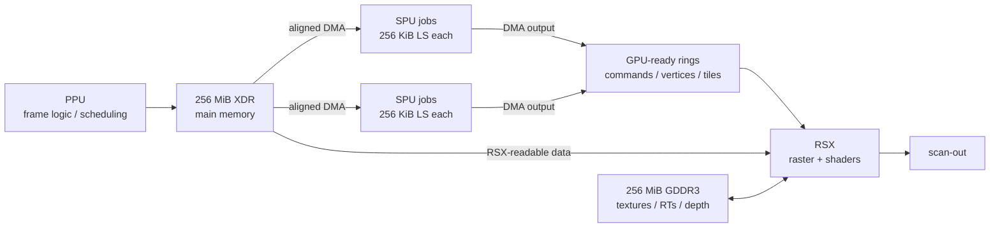
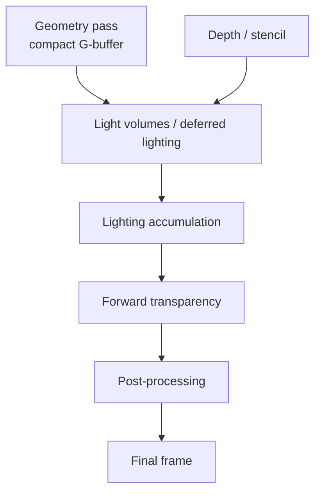

# PlayStation 3 Rendering at Full Throughput: Cell/RSX Engine Optimisation

## Executive summary

The PlayStation 3 was not made fast by treating its Cell Broadband Engine as an unusually complicated conventional CPU and its RSX as an ordinary PC GPU. The engines that extracted the most from it instead treated the machine as a **streaming heterogeneous processor**: the PPU organised work, the SPUs pulled explicitly managed blocks into 256 KiB local stores, transformed or classified those blocks with SIMD code, and pushed compact output towards an RSX that was kept busy on the work it performed best. Sony's own Cell guidance reduces the core strategy to explicit local-store management, aligned DMA and overlap of transfer with computation; IBM's documentation likewise makes clear that an SPU cannot simply dereference arbitrary main-memory data as though it had a cache. citeturn13view2turn13view0

The practical consequence is that **data movement and scheduling were as important as arithmetic throughput**. Each SPE has a 256 KiB local store shared by its instructions and working data, 128 × 128-bit registers, SIMD-oriented execution, and an MFC DMA engine. DMA operations are asynchronous; individual transfers top out at 16 KiB, and IBM recommends 128-byte alignment and transfer sizes that are even multiples of 128 bytes for peak transfer behaviour. SPU loads/stores themselves operate on 16-byte vectors. citeturn13view0turn13view2

The retail machine also had a hard split between **256 MiB of XDR main memory and 256 MiB of GDDR3 graphics memory**, rather than a modern unified pool. Sony's retail documentation confirms the 256 + 256 MiB organisation. The XDR interface offered 25.6 GB/s theoretical bandwidth, while the shipping RSX's 128-bit GDDR3 interface was about 20.8 GB/s; communication between Cell and RSX used asymmetric FlexIO links. This made placement, direction of transfers and avoiding readbacks unusually important. citeturn5view1turn3search2turn25search22turn22search24

The most successful PS3 rendering systems therefore followed several recurring rules:

1. **Keep the PPU out of per-object/per-vertex hot loops.** Use it to build job descriptors and high-level frame state, then let SPUs traverse scene data, cull, skin, generate geometry, build command/display lists and perform selected image-space algorithms. Guerrilla's *Killzone 2* renderer explicitly moved scene traversal, visibility, skinning, triangle trimming, particles and display-list generation onto SPUs. citeturn5view0turn25search1
2. **Overlap everything possible.** DMA block *n+1* while computing block *n* and writing block *n−1*; schedule SPU jobs concurrently with RSX work from another part of the frame. Double buffering is canonical; triple buffering is useful when input DMA, computation and output DMA all need independent storage, provided the extra buffers still fit the 256 KiB local store. citeturn13view0turn13view2
3. **Feed RSX less work, not merely faster work.** Sony/Naughty Dog's *RSX Best Practices* presentation recommended SPU-side decompression, blend shapes, skinning, progressive-mesh processing, triangle culling, vertex compaction and stream recombination before RSX consumption. Its suggested SPU geometry partitions were roughly 500–1,500 vertices rather than giant meshes. citeturn23view0
4. **Reduce command-generation overhead.** Prebuild static portions of command buffers, patch only changing addresses/constants/draw counts, sort/batch state and let SPUs generate dynamic command-list sections. *Killzone 2* went as far as having SPUs pull rendering data directly from object descriptions and build display lists without conventional virtual `Draw()` calls. citeturn23view0turn5view0
5. **Attack RSX bandwidth and fill rate.** Compact G-buffers, depth pre-passes where appropriate, early rejection, half/quarter-resolution effects, compressed textures, shorter shaders and limited transparency were often more valuable than adding ALU work elsewhere. *Killzone 2* used four RGBA8 render targets plus D24S8 for its deferred G-buffer—about 36 MiB at its 720p Quincunx-MSAA configuration—and rendered fill-heavy transparent effects at reduced resolution. citeturn25search1turn5view0
6. **Use the SPUs as the PS3's “asynchronous compute” resource.** RSX had no modern compute-shader queue. Nevertheless, SPUs could perform graphics-adjacent computation concurrently with GPU work: geometry processing, light culling/shading, post-processing, particles and command generation. DICE took this to its logical extreme in *Battlefield 3*, shading deferred-lighting tiles on five SPUs. citeturn4search11turn7search0

The central engineering insight is therefore:

> **The fastest PS3 renderer was usually a pipeline that transformed large, irregular, high-level game data into small, aligned, preculled, GPU-ready streams before RSX ever saw them.**

That principle matters more than any isolated trick such as “use all SPUs” or “move vertices to XDR”. Placement and offload decisions had to follow the bottleneck: a fill-bound deferred renderer, vertex-bound character scene, PPU-bound draw submission and texture-streaming-heavy open world demanded different balances.

A useful mental model is:



This is a synthesis of IBM's Cell data-flow model, Sony/Naughty Dog's SPU geometry pipeline and real engines such as *Killzone 2* and *Battlefield 3*. citeturn13view0turn23view0turn5view0turn4search11

## Hardware architecture and performance constraints

**Cell and the PPU.** Cell contains one Power Processor Element and eight SPEs architecturally. In the PlayStation 3 configuration, six SPEs were available to normal application/game workloads: one physical SPE was disabled for manufacturing yield and another was reserved by the system environment. Contemporary PS3 scientific-computing literature documents the resulting six-SPE application configuration explicitly. citeturn13view2turn25search14

The PPE/PPU is a 64-bit PowerPC processor intended in Cell's design to orchestrate heterogeneous work rather than behave like a large contemporary out-of-order desktop CPU. That difference is critical: an engine dominated by pointer-heavy object traversal, thousands of tiny virtual calls, command-state validation and fine-grained locks could become PPU-bound long before the aggregate arithmetic capacity of Cell had been exploited. The original IBM Cell architecture literature and Cell programming tutorial consequently emphasise distribution of parallel, SIMD-friendly work to SPEs rather than centralising computation on the PPE. citeturn12search9turn13view0

**The SPE/SPU execution model.** Each SPE combines an SPU execution core, a 256 KiB local store and a Memory Flow Controller. The SPU has 128 128-bit registers; both code and data must reside in local store to be directly executed/accessed. Main-memory data arrives through MFC DMA operations rather than through a transparent cache hierarchy. citeturn13view0turn13view2

That gives an SPU program a fundamentally different performance model from normal CPU code:

- local-store hits are predictable, because the programmer explicitly chooses what is resident;
- main-memory latency can be hidden because MFC DMA proceeds independently of the SPU's arithmetic;
- random pointer chasing is hostile because every missing piece of data may require another explicitly scheduled transfer;
- code size matters because executable instructions consume the same 256 KiB local store as input, output, stacks and scratch buffers;
- algorithms benefit enormously when data can be processed as independent blocks. citeturn13view0turn13view2

IBM documents SPU loads/stores as 16-byte operations and describes the SPU's two execution pipelines: instructions can dual-issue when an “even” and an “odd” pipeline instruction are suitably paired. Loads, stores, branches and arithmetic therefore have to be scheduled with dependency latency in mind; merely recompiling scalar PPU code for an SPU was rarely the end of optimisation. citeturn13view0

**DMA and alignment.** These are among the most important PS3 optimisation facts:

| Cell/SPE property | Practical implication |
|---|---|
| 256 KiB local store | Partition working sets; do not design SPU jobs around whole-world objects. citeturn13view0turn13view2 |
| 16-byte SPU load/store granularity | Lay hot arrays out as SIMD vectors and avoid repeated unaligned extraction. citeturn13view0 |
| Up to 16 KiB in one ordinary DMA transfer | Large jobs must stream multiple blocks rather than issue one giant transfer. citeturn13view0 |
| 128-byte aligned EA/LS addresses and 128-byte-multiple transfers recommended for peak DMA | Align transfer blocks and pad/aggregate tiny messages. citeturn13view0turn13view2 |
| DMA commands are queued/asynchronous and have tag IDs | Issue future transfers early and wait only immediately before data is consumed. citeturn13view0 |
| DMA-list support | Gather several non-contiguous source ranges with fewer CPU-side scheduling steps. citeturn13view0 |

The classic loop is therefore **get → compute → put**, overlapped across different buffers rather than executed serially.

A Cell-SDK-style skeleton looks like this. The API names follow IBM's public MFC interface; this is deliberately a compact illustrative kernel rather than copied Sony SDK code. citeturn13view0turn13view2

```c
#include <spu_mfcio.h>
#include <stdint.h>

enum {
    TAG_IN0  = 0,
    TAG_IN1  = 1,
    TAG_OUT0 = 2,
    TAG_OUT1 = 3,
    BLOCK    = 16 * 1024
};

static unsigned char in_buf[2][BLOCK]
    __attribute__((aligned(128)));
static unsigned char out_buf[2][BLOCK]
    __attribute__((aligned(128)));

static inline void wait_tag(unsigned tag)
{
    mfc_write_tag_mask(1u << tag);
    (void)mfc_read_tag_status_all();
}

void stream_blocks(uint64_t input_ea,
                   uint64_t output_ea,
                   unsigned block_count)
{
    if (block_count == 0)
        return;

    /* Prime the pipeline. */
    mfc_get(in_buf[0], input_ea, BLOCK, TAG_IN0, 0, 0);

    for (unsigned i = 0; i < block_count; ++i) {
        const unsigned cur  = i & 1u;
        const unsigned next = cur ^ 1u;
        const unsigned in_tag  = cur ? TAG_IN1  : TAG_IN0;
        const unsigned next_tag = next ? TAG_IN1 : TAG_IN0;
        const unsigned out_tag = cur ? TAG_OUT1 : TAG_OUT0;

        /* Start transfer for the following block before computing this one. */
        if (i + 1 < block_count) {
            mfc_get(in_buf[next],
                    input_ea + (uint64_t)(i + 1) * BLOCK,
                    BLOCK, next_tag, 0, 0);
        }

        wait_tag(in_tag);

        /*
         * SIMD-friendly processing.
         * Keep this working set wholly inside local store.
         */
        process_block_simd(out_buf[cur], in_buf[cur], BLOCK);

        /* Output transfer overlaps later computation. */
        mfc_put(out_buf[cur],
                output_ea + (uint64_t)i * BLOCK,
                BLOCK, out_tag, 0, 0);

        /*
         * Before reusing out_buf[cur] two iterations later,
         * production code must ensure its previous PUT has completed.
         */
    }

    wait_tag(TAG_OUT0);
    if (block_count > 1)
        wait_tag(TAG_OUT1);
}
```

For a kernel with substantial output, a **three-stage local-store pipeline** is often conceptually cleaner:

```text
buffer A: DMA GET block n+1
buffer B: execute SIMD kernel on block n
buffer C: DMA PUT result n-1
```

Triple buffering does not magically improve bandwidth; it buys additional independence between stages. On an SPE it also consumes scarce local store, so a smaller double-buffered kernel can outperform a more elaborate triple-buffered design when the latter forces code/data spills or smaller useful batches. That trade-off follows directly from the explicit 256 KiB local-store model. citeturn13view0turn13view2

**Memory architecture.** The PS3 has two physically distinct 256 MiB pools. Main XDR memory belongs naturally to Cell; RSX has a separate 256 MiB GDDR3 pool. RSX can also fetch selected resources from main memory through the Cell/RSX interface, but this is not equivalent to UMA: bandwidth, latency and directionality differ. Sony's early PS3 specification quoted 25.6 GB/s for main RAM and asymmetric 20/15 GB/s Cell/RSX interconnect figures; the shipping GDDR3 configuration is generally documented at roughly 20.8 GB/s. citeturn3search2turn5view1turn25search22turn22search24

The best engine architecture consequently treated memory placement as a first-class rendering decision:

**XDR was attractive for** job data, scene structures, SPU input/output rings, dynamically generated geometry and some RSX-readable streaming data.

**GDDR3 was precious for** high-reuse textures, depth buffers, render targets and resources whose performance was dominated by repeated RSX-side access.

**CPU/SPU reads of GPU-produced information were avoided whenever possible.** Synchronising Cell with RSX merely to read a result back destroys pipeline overlap as well as consuming an unfavourable transfer path; PS3 engines generally used fences/reports and compact metadata rather than full-surface readback where they could. The asymmetric Cell/RSX data paths documented by PS3 architectural references are why “just put everything in VRAM” and “just use XDR as extra VRAM” were both poor universal rules. citeturn25search22turn22search24

**RSX.** RSX is a GeForce-7-generation, non-unified GPU with distinct vertex and fragment processing resources, a 128-bit GDDR3 interface and the conventional immediate-mode rasterisation model of that generation. It is therefore important not to confuse PS3 “tiled rendering” techniques with a mobile-style tile-based deferred GPU: software divided work into tiles, and RSX supported tiled surface layouts, but RSX itself was not a TBDR architecture. citeturn22search18turn22search24

Low-level PS3 renderers normally targeted **libGCM/GCM**, emitting commands into an RSX command buffer. Sony/Naughty Dog's *RSX Best Practices* material discusses multiple command-buffer buckets, direct state construction, static command-buffer patching and SPU-generated portions of that stream. The open PSL1GHT implementation exposes the same conceptual model publicly: its RSX API initialises a command buffer in main memory, manages RSX-visible memory and exposes surface, flip and draw commands. citeturn23view0turn21view1

PSGL offered a higher-level OpenGL-derived interface, but the performance-oriented first-party material is overwhelmingly instructive because it shows how far engines could go when treating the command stream itself as data.

## Rendering pipelines that worked on PS3

There was no single “PS3 rendering pipeline”. Several patterns emerged depending on whether the title was CPU/geometry bound, shader/fill bound, memory bound or dominated by many dynamic lights.

**Forward rendering.** A conventional forward renderer remained attractive for simpler material/light models and was effectively mandatory for many transparent surfaces. *Killzone 2*, despite being famous for deferred rendering, still used a forward pass for transparency. Guerrilla limited that path to a manageable lighting model and even used per-vertex lighting for some particle workloads. citeturn5view0

The PS3 optimisation of a forward renderer was therefore less about inventing another lighting equation and more about:

```text
scene/SPU visibility
    ↓
depth / opaque front-to-back work
    ↓
batched opaque shading on RSX
    ↓
transparent/particle forward pass
    ↓
post-processing
```

Early depth rejection and avoiding excessive fragment work mattered greatly because RSX had much less local-memory bandwidth and ROP capacity than a contemporary high-end desktop GPU. Sony's “Cutting Edge Techniques” material explicitly recommends object/occlusion/vertex culling before RSX, followed by RSX early-Z and a depth pre-pass where appropriate. citeturn19search5

**Deferred shading.** Guerrilla's *Killzone 2* is the canonical public case study. Its G-buffer used four 32-bit RGBA render targets plus a 24-bit depth/8-bit stencil surface. The stored quantities included normal components, motion vectors, specular information, albedo and lighting-related values; position was reconstructed from depth rather than written as another full position target. Guerrilla put the configuration at roughly 36 MiB for 720p with its Quincunx MSAA setup. citeturn25search1

That design illustrates the PS3 deferred-rendering trade:



Deferred lighting reduced repeated material shading and made large numbers of lights practical, but its MRT footprint put direct pressure on the PS3's small 256 MiB local graphics memory and GDDR bandwidth. Guerrilla therefore packed values aggressively, reconstructed values such as normal-Z or position where worthwhile, and moved fill-heavy effects to half/quarter resolution. citeturn25search1turn5view0

**SPU-assisted geometry pipeline.** Sony/Naughty Dog's *RSX Best Practices* shows perhaps the most PS3-specific pipeline:

```text
compressed mesh
   ↓ DMA
SPU decompression
   ↓
blend shapes
   ↓
skinning
   ↓
progressive-mesh / LOD processing
   ↓
triangle culling
   ↓
vertex compaction
   ↓
recompression / stream interleave
   ↓ DMA
RSX-ready vertex + index buffers
   ↓
RSX raster/shading
```

The presentation explicitly describes this as an SPU geometry pipeline whose output can be consumed directly by RSX. It recommends partitioning meshes into SPU-manageable “vertex sets”, with roughly 500–1,500 vertices per set presented as a useful scale; smaller partitions also make triangle-level culling more effective. citeturn23view0

This is the conceptual foundation of Sony's proprietary **PlayStation Edge Geometry** technology. The publicly presented Edge material describes SPU-side skinning, culling and compressed vertex output; the library itself was part of Sony's licensed development stack rather than an open-source project. citeturn19search1turn19search28

**SPU-generated rendering commands.** *Killzone 2* moved not only geometry but the higher-level render traversal onto SPUs. Guerrilla's public slides list display-list generation for main rendering, lights/shadows and forward rendering, alongside scene-graph traversal, visibility culling, skinning and triangle trimming. Its objects stored data-driven “DrawParts” decision structures; SPUs selected LOD/material parts and constructed the resulting display list. citeturn5view0

That is a profound optimisation because it addresses both sides of the pipeline simultaneously: it reduces PPU overhead **and** can prevent invisible/irrelevant data from reaching RSX.

**SPU tiled deferred shading.** DICE's *Battlefield 3* went further and moved part of deferred lighting itself to Cell. The screen was divided into 64×64-pixel tiles. SPUs fetched G-buffer/depth data into local store, detiled it, determined depth bounds, culled lights against a tile frustum, subdivided work into 32×16 subtiles, performed the shading and DMA'd results out. citeturn4search11turn8view3

The job allocator used a shared atomic tile counter rather than statically assigning equal numbers of tiles to SPUs. That matters because screen tiles can have radically different light counts: dynamic pull scheduling naturally load-balanced the six-way heterogeneous workload. DICE also fetched light descriptors in groups of 16 with a single DMA and double-buffered those batches while culling. citeturn8view3turn8view4

This is **tiled deferred shading**, not modern GPU compute and not a hardware tile renderer. It is nevertheless remarkably close in spirit to later tiled/clustered light-list construction: identify a spatial screen region, determine a conservative depth volume, reject lights before expensive shading, then shade only the survivors. citeturn8view3

**SPU post-processing.** Image-space work was also a viable Cell workload. *Killzone 2* generated per-frame LUT textures on SPUs and used SPUs elsewhere in its rendering pipeline; Sony's Edge work later included an SPU MLAA implementation, and *God of War III* publicly discussed using SPUs to assist rendering alongside simulation and scene processing. citeturn5view0turn19search31turn19search0

The key condition was that the image algorithm could be split into tiles/scan-line regions with bounded neighbourhood data. That makes its memory behaviour compatible with local-store streaming.

## Optimisation techniques in detail

The following table should be read as **bottleneck-dependent**, not as universal percentage gains. “Impact” means potential importance when the relevant subsystem is actually limiting frame time; several techniques can make performance worse if used in the wrong regime.

| Technique | Expected impact | Complexity | Typical PS3 use | Evidence / caveat |
|---|---:|---:|---|---|
| SPU scene traversal and display-list generation | Very high when PPU/draw-call bound | High | Dense scenes, many objects/materials | Used heavily by *Killzone 2*. citeturn5view0 |
| SPU skinning / blend shapes | High when vertex/RSX bound | Medium–high | Characters, crowds, deformable meshes | Sony/Naughty Dog recommend moving these stages into the SPU geometry pipeline. citeturn23view0 |
| SPU triangle trimming/culling | High with high geometric overdraw | High | Dense terrain, characters, shadow meshes | Public Sony/Naughty Dog and Guerrilla pipelines used it. citeturn23view0turn5view0 |
| 128-byte-aligned batched DMA | High for SPU-heavy engines | Medium | Every streaming SPU kernel | IBM recommends 128-byte alignment/multiple for peak DMA behaviour. citeturn13view0turn13view2 |
| Double-buffer DMA | High if otherwise latency-bound | Medium | Geometry, lights, particles, post-FX | Canonical Sony/IBM Cell pattern. citeturn13view2 |
| Triple-stage GET/compute/PUT buffering | Medium–high | Medium–high | Kernels with simultaneous heavy input/output | Useful only if the additional LS footprint does not hurt the kernel; inference from the Cell buffering model. citeturn13view0 |
| Dynamic SPU work stealing / tile counter | High for irregular workloads | High | Lighting tiles, visibility regions | DICE atomically allocated next 64×64 tile. citeturn8view3 |
| Tiled/depth-bounded light culling | Very high with many lights | High | Deferred lighting | DICE's 64×64 → 32×16 hierarchy. citeturn8view3 |
| Hierarchical frustum/occlusion/triangle culling | Very high in complex scenes | High | Most 3D games | Sony material and DICE both use coarse-to-fine rejection. citeturn19search5turn8view3 |
| LOD/progressive mesh selection on SPU | Medium–high | High | Open environments, character crowds | Part of Sony's public SPU geometry pipeline; *Killzone 2* chose DrawParts/LOD on SPUs. citeturn23view0turn5view0 |
| Compressed vertex input → SPU expand → compressed RSX output | High for memory/bandwidth | High | Large animated/static mesh sets | Explicitly described in *RSX Best Practices*. citeturn23view0 |
| Combine RSX vertex streams | Medium | Low–medium | Virtually all geometry | Sony/Naughty Dog state fewer streams perform better and recommend recombination on SPU output. citeturn23view0 |
| Static/prebuilt command buffers | High when submission bound | Medium | Repeated materials/meshes | *RSX Best Practices* discusses patching/concatenating static command chunks. citeturn23view0 |
| Batching / instancing-style submission | Medium–high | Medium | Repeated props, particles, crowds | Main gain is fewer state/command transitions; public PS3 evidence is strongest for command-buffer reuse/batching rather than one universal instancing API path. citeturn23view0 |
| Compact deferred render targets | Very high when bandwidth/VRAM bound | High | Deferred renderers | *Killzone 2* packed four RGBA8 targets and reconstructed values. citeturn25search1 |
| Half/quarter-resolution effects | High when fill-bound | Low–medium | Particles, blur, depth-of-field, volumetrics | Used by Guerrilla for fill-heavy effects. citeturn5view0 |
| Texture compression + mip streaming | High for VRAM/IO pressure | High | Texture-rich/open-world titles | RSX supports S3TC; streaming design must accommodate the 256 MiB VRAM limit. citeturn22search24turn5view1 |
| SPU image-space/post processing | Medium–very high | High | MLAA, LUTs, selected filters | Demonstrated by Guerrilla and PlayStation Edge/God of War work. citeturn5view0turn19search31 |
| SPU/RSX asynchronous overlap | Very high if dependencies permit | Very high | Any mature PS3 renderer | Core idea behind Edge geometry, just-in-time buffers and Battlefield SPU shading. citeturn23view0turn4search11 |

**SPU offload pattern.** The most important criterion for deciding whether code belonged on an SPU was not “is this arithmetic expensive?” but **can the input and output be turned into bounded streams?** Skinning works because a vertex partition, skin matrices and output region are finite. Tile lighting works because a 64×64 tile and a light batch fit a controlled working set. A linked scene graph full of arbitrary C++ pointers is initially poor SPU material; *Killzone 2* solved that by making rendering data-driven enough that SPUs could pull compact rendering descriptions. citeturn5view0turn23view0

A good SPU task descriptor therefore looks more like:

```cpp
struct alignas(128) GeometryJob
{
    uint64_t compressed_vertices_ea;
    uint64_t indices_ea;
    uint64_t matrices_ea;
    uint64_t output_vertices_ea;
    uint64_t output_indices_ea;

    uint32_t vertex_count;
    uint32_t index_count;
    uint32_t material_id;
    uint32_t flags;

    float lod_parameter;
    float padding[15];   // Make job record transfer-friendly.
};
```

than:

```cpp
struct BadSpuJob
{
    GameObject* object;        // arbitrary pointer tree
    Renderer* renderer;
    std::vector<Mesh*> meshes; // nested allocations/pointer chasing
};
```

The exact padding/layout depends on the real job system, but the principle follows IBM's explicit-transfer model: make one or a few predictable DMAs expose all metadata necessary to start useful work. citeturn13view0turn13view2

**DMA batching.** One 128-byte or multi-kilobyte transfer is preferable to a storm of tiny requests not because DMA itself is “slow”, but because transactions and waits must be amortised. DICE's deferred-lighting implementation gives a concrete production example: it DMA'd light data in groups of 16 and double-buffered batches so the next group could arrive while the current one was culled. citeturn8view3turn8view4

Conceptually:

```c
for (;;) {
    unsigned batch = acquire_next_light_batch();

    dma_get_async(next_ls_lights,
                  main_lights + batch * 16,
                  sizeof(Light) * 16,
                  next_tag);

    cull_and_shade(current_ls_lights);

    dma_wait(next_tag);
    swap(current_ls_lights, next_ls_lights);
}
```

**Data-oriented local-store layout.** A useful PS3 engine frequently had *different* layouts on different sides of a job.

Inside an SPU kernel, structure-of-arrays can make four-wide SIMD processing straightforward:

```cpp
struct alignas(128) LightBlock
{
    float x[16];
    float y[16];
    float z[16];
    float radius[16];

    float r[16];
    float g[16];
    float b[16];
};
```

At the RSX boundary, however, Sony/Naughty Dog recommend combining vertex attributes into fewer interleaved streams because fewer RSX vertex streams improve fetch behaviour. Their geometry pipeline therefore decompressed convenient source streams to SPU-friendly float tables and recompressed/interleaved the final output for RSX. citeturn23view0

That apparent contradiction—SoA for computation, interleaved output for GPU consumption—is exactly the sort of transformation Cell was well suited to perform.

**Geometry partitioning and culling.** A mesh too large to fit comfortably in local store should be divided offline. Sony/Naughty Dog reported SPU vertex sets in the approximate 500–1,500-vertex range, with only about 7–10% duplicated-data overhead in their example compared with much smaller PS2-era partitions. Smaller partitions also let the culler discard spatially irrelevant pieces earlier. citeturn23view0

Within a partition, a useful rejection sequence is:

```text
object/partition frustum test
       ↓ survives
optional occlusion test
       ↓ survives
LOD selection
       ↓
SPU transform / skin
       ↓
back-face + off-screen + degenerate +
sub-pixel triangle trimming
       ↓
compact index list
       ↓
remove now-unreferenced vertices if worthwhile
       ↓
RSX
```

Sony's slides explicitly identify off-screen, back-facing, degenerate and sufficiently small triangles as candidates for SPU culling. They also report that their later vertex-remapping stage could remove roughly 30% of vertex data in the shown case, while yielding only minor additional RSX performance—an important reminder that a bandwidth reduction does not automatically translate into an equivalent frame-time gain. citeturn23view0

**Draw-call reduction and command generation.** PC-era wisdom such as “batch draw calls” applies, but the low-level reason on PS3 is particularly clear: command construction itself is CPU work, and excess state validation or abstraction overhead can consume precious PPU time.

Sony/Naughty Dog's approach included:

- command buffers with minimal runtime state interpretation;
- multiple command “buckets” for sorting;
- static command chunks;
- holes/pointers patched after SPU geometry processing;
- dynamic draw/index information inserted just in time;
- optional single-frame output buffering where SPU production and RSX consumption tightly overlap. citeturn23view0

The basic pattern is analogous to a modern indirect-command build:

```cpp
// Built once/offline or cheaply on the PPU.
CommandBlock block = build_static_material_state(material);

// Dynamic part is deliberately small.
struct DrawPatch {
    uint32_t vertexOffset;
    uint32_t indexOffset;
    uint32_t indexCount;
    uint32_t constantsOffset;
};

// SPU generates geometry + patch data.
DrawPatch patch = process_mesh_on_spu(meshJob);

// Command list builder substitutes only dynamic values.
patch_command_block(block, patch);
submit(block);
```

*Killzone 2* shows the more aggressive version: its SPUs traversed scene data and constructed rendering lists themselves rather than funneling every visible object through a conventional object-oriented PPU draw call. citeturn5view0

For repeated geometry, **instancing is best understood as one member of this larger submission-reduction strategy**. Where an engine's RSX abstraction could express hardware-style per-instance data, it could reduce duplicated vertex work and commands; when it could not, repeated prebuilt command blocks with small per-instance constant/address patches achieved much of the CPU-side objective. Public PS3 presentations provide much firmer measured evidence for batching/static command streams than for a single canonical PS3 instancing recipe. citeturn23view0

**Shaders.** RSX optimisation was closer to GeForce 7 optimisation than to contemporary unified-GPU programming. Separate vertex and fragment resources meant moving work between pipeline stages could matter, and fragment complexity had to be considered alongside texture, ROP and GDDR traffic. citeturn22search18turn22search24

A typical Cg fragment path might deliberately reconstruct rather than store a third normal component:

```c
// Illustrative Cg-style fragment code.
// G-buffer stores only normal X/Y.
half2 nxy = tex2D(normalTex, uv).xy * 2.0h - 1.0h;

half nz2 = saturate(1.0h - dot(nxy, nxy));
half3 n  = half3(nxy, sqrt(nz2));

half3 l = normalize(lightVector);
half ndotl = saturate(dot(n, l));

return half4(albedo.rgb * lightColour * ndotl, 1.0h);
```

*Killzone 2* explicitly reconstructed normal-Z from X/Y and reconstructed position from depth/pixel coordinates, trading arithmetic for G-buffer storage/bandwidth. citeturn25search1

The general RSX shader rules were:

- specialise shaders rather than carry large amounts of dead material functionality;
- minimise overdraw before optimising individual ALU instructions;
- use lower precision where the resulting image quality and generated code justify it;
- pack varyings/render-target values rather than writing unnecessary full precision;
- avoid expensive texture dependencies and unnecessary samples;
- use an early depth pass when its saved fragment work exceeds the cost of the extra geometry pass;
- profile shader permutations rather than assuming more arithmetic is always worse than more bandwidth.

DICE used analogous specialisation on its SPU deferred shader: material classification selected specialised code paths so, for example, skin-specific shading was not run for tiles that contained no skin pixels. citeturn8view3

**Texture streaming and compressed formats.** The 256 MiB GDDR3 budget made keeping every high-resolution texture resident impossible for texture-heavy games. RSX supports S3TC/DXT-family block compression, so maintaining GPU-native compression through the content pipeline reduced both storage and VRAM footprint relative to expanded RGBA data. citeturn22search24

A robust PS3 streaming model was consequently:

```text
Blu-ray / HDD
      ↓ asynchronous I/O
compressed mip pages
      ↓
XDR staging/ring
      ↓                  ↘ optionally RSX-readable resource
copy/upload as needed      XDR
      ↓
GDDR resident mip cache
      ↓
RSX sampling
```

The most important practical rules are architectural consequences of the split memory: stream **mip levels rather than whole textures**, batch I/O and uploads, keep a low-resolution resident tail so objects never become wholly untextured, avoid decompression into unnecessarily larger intermediate images, and do not synchronously evict/upload in the render loop. Sony's wider PS3 development stack included FIOS as an optimised I/O layer, although most publicly available rendering presentations document geometry and lighting optimisation much more thoroughly than proprietary production texture-streaming implementations. citeturn19search32turn5view1

**Render-target management.** G-buffer and post-processing surfaces are a disproportionate consumer of a 256 MiB VRAM pool. *Killzone 2* demonstrates three effective responses: compact formats, reconstructing values from depth/other channels, and reduced-resolution passes. citeturn25search1turn5view0

A serious PS3 allocator should also treat transient targets as lifetimed resources rather than permanent allocations: two render targets used in non-overlapping phases can occupy the same backing memory if synchronisation is correct. That is an engine-level allocation technique rather than a special RSX instruction, but the PS3's exceptionally small split pools made the payoff unusually large.

**Software tiling versus RSX tiled surfaces.** Two distinct meanings must not be conflated:

- **software work tiling** divides lighting, post-processing or visibility into screen regions so SPUs can process independent bounded jobs; *Battlefield 3* is the prime example; citeturn8view3
- **RSX tiled memory/surface layout** is a GPU memory-layout facility used by render/depth surfaces and exposed by the underlying RSX/GCM machinery; contemporary reverse-engineering and open implementations document it, but it does **not** turn RSX into a hardware tile-based deferred renderer. citeturn22search3turn25search22

**Asynchronous compute.** In modern terminology, PS3 has no RSX asynchronous compute queue. The equivalent engineering opportunity was to make **Cell and RSX execute different sections of the graphics frame concurrently**.

A mature frame could resemble:

```mermaid
gantt
    title PS3 frame overlap — conceptual
    dateFormat X
    axisFormat %L

    section PPU
    Build jobs N+1          :0, 3
    Gameplay / submit       :3, 4

    section SPUs
    Cull + skin N           :1, 5
    Build command data N    :5, 7
    Post / lighting work N  :7, 10

    section RSX
    Render frame N-1        :0, 8
    Post / present N-1      :8, 10
```



Sony/Naughty Dog's single-buffer geometry mode explicitly describes SPUs creating geometry **just in time while RSX is rendering**, with command-buffer holes patched dynamically; the trade-off is tighter SPU↔RSX synchronisation. Their whole-frame double-buffer mode is easier to synchronise but consumes more memory and adds another stage of latency. citeturn23view0

The goal is not maximum SPU utilisation for its own sake. The useful objective is to minimise the time in which **PPU, all useful SPUs or RSX are idle while another processor sits on the critical path**.

## Evidence, microbenchmarks and case studies

Public PS3 performance data is less uniform than modern GPU benchmark literature because the most useful Sony SDK tools and production source trees were proprietary. Nevertheless, several unusually concrete measurements and implementation numbers survive in original presentations.

**IBM DMA and SPU limits.** IBM's programming tutorial specifies a maximum ordinary MFC DMA size of 16 KiB and says peak transfer performance is obtained when local-store and effective addresses are 128-byte aligned and the transfer is an even multiple of 128 bytes. It also documents 16-byte SPU loads/stores and dual-pipeline instruction issue. These are architectural limits/guidelines, not synthetic game-frame numbers, but they are the most transferable “microbenchmark” facts because every SPU rendering kernel inherits them. citeturn13view0

Sony's own Cell programming-practice material repeats the practical rule: **128-byte alignment for DMA, 16-byte alignment for SPE work**, and illustrates double buffering specifically to overlap computation and communication. citeturn13view2

**SPU geometry partition size.** Sony/Naughty Dog's *RSX Best Practices* gives the rare production-scale geometry number: an SPU could conveniently handle vertex sets of roughly **500–1,500 vertices** in the presented pipeline. The deck reports approximately **7–10% duplicated vertex-data overhead** from such partitioning, compared with roughly 30% in the much smaller PS2-style partitions they discuss. citeturn23view0

The same presentation reports that removing vertices made unused after triangle culling removed around **30% of the vertex data in its example**, but produced “minor performance gains on the RSX, if any”. This is analytically valuable: optimising bytes moved is not enough; determine which unit's time actually lies on the critical path. citeturn23view0

**Command-construction overhead.** The same deck contains microbenchmarks for libGCM command construction. Its space-checking examples show seemingly trivial state-setting wrappers carrying several-times-baseline overhead before tighter checking paths bring calls much closer to baseline; the slides show alpha-blend setup around the 5× range in one checked case and later near 1.1×, and texture setup similarly approaching about 1.05× in the optimised example. These are command-generation microbenchmarks, **not RSX rendering-speed multipliers**, but they explain why first-party engines cared enough to eliminate layers of per-command checking and patch static command buffers directly. citeturn23view0turn26search22

**Killzone 2 deferred renderer.** Guerrilla's four-RGBA8-plus-D24S8 G-buffer consumed approximately **36 MiB** at 720p with its MSAA configuration. The talk also describes an MSAA lighting method whose measured performance was stated as equal to the non-MSAA case in that engine, while shadow filtering used at most 12 taps in the discussed implementation. Those figures are specific to Guerrilla's pipeline rather than general RSX properties. citeturn25search1turn5view0

More important structurally, Guerrilla lists SPU execution of:

- main/light-shadow/forward display-list generation;
- scene graph traversal and visibility;
- skinning;
- triangle trimming;
- image-based-lighting generation;
- particles. citeturn5view0

That is strong primary evidence that late-generation PS3 optimisation was not merely “put physics on SPUs”; first-party engines moved large pieces of the renderer's **front end** there.

**Battlefield 3 SPU deferred shading.** Christina Coffin's DICE GDC presentation documents:

- 64×64 main tiles;
- 32×16 subtiles;
- asynchronous DMA/detiling into local store;
- depth-derived tile frusta;
- tile/subtile light culling;
- batches of 16 light records per DMA;
- double-buffered light data;
- dynamic tile allocation across SPUs. citeturn4search11turn8view3

A performance slide quotes a deferred **shading budget greater than 40 ms “split across 5 SPUs”**, and roughly **1–4 ms of culling work for 1,000+ lights**. The >40 ms figure should not be interpreted as a >40 ms wall-clock frame stage: it represents aggregate work distributed over five SPUs, so the effective elapsed time depends on parallel balance and overlap. The deck's larger point is that Cell supplied enough otherwise-unused aggregate execution time to move a substantial lighting workload off RSX. citeturn8view3

**God of War III.** Sony Santa Monica's “Practical SPU Programming in God of War III” describes an incremental strategy rather than one heroic rewrite: identify expensive simulation, scene and rendering functions; package work into parallel batches; move those batches to SPUs; and use an in-engine profiler to locate remaining stalls. This reinforces an important engineering lesson from PS3 development—successful SPU adoption generally came from a **job system plus repeatable data-transfer conventions**, not handcrafted one-off assembly everywhere. citeturn19search0turn19search3

**Uncharted.** Naughty Dog's public *The Technology of Uncharted: Drake's Fortune* material documents its PS3-specific engine development and extensive Cell/SPU use. Combined with later Naughty Dog contributors on *RSX Best Practices*, it provides a useful progression: early engines learned how to offload isolated systems; later first-party techniques increasingly treated SPUs as a programmable geometry/rendering front end. citeturn19search2turn23view0

A useful hierarchy for optimisation decisions, supported by these case studies, is therefore:

```text
Is RSX idle waiting for commands?
    → optimise PPU/SPU traversal and command generation.

Is RSX vertex/geometry bound?
    → SPU skinning, triangle trimming, compressed streams, LOD.

Is RSX fragment/fill bound?
    → early depth/culling, lower-resolution effects, fewer samples,
      move suitable image/lighting work to SPUs.

Is Cell/SPU waiting on memory?
    → larger aligned batches, double buffering, DMA lists,
      smaller/local working sets.

Are SPUs imbalanced?
    → dynamic job queues / tile work stealing.

Is VRAM pressure causing churn?
    → compression, mip streaming, transient RT aliasing,
      reconsider XDR versus GDDR placement.

Is nothing clearly dominant?
    → stop changing code and profile again.
```

That last step is particularly important on PS3: optimisation often moved the bottleneck from PPU → SPU DMA → RSX vertex work → RSX fill → memory bandwidth. A locally faster stage could have no effect at all once it left the critical path.

## Profiling and engineering workflow

The commercial PS3 development environment had considerably better tooling than is sometimes assumed from the architecture's reputation.

**GCM Replay.** Sony's public Edge/RSX presentations describe **GCM Replay** as an RSX analysis, debugging and profiling tool consisting of a small runtime library plus a Windows/PS3 development-tool application. It could capture/replay the GPU command workload, making it possible to isolate graphics behaviour without repeatedly running the entire game. It was an official proprietary developer tool rather than an open utility. citeturn26search0turn26search22

**SN Systems ProDG and Tuner.** Sony announced in November 2007 that ProDG would become part of the PS3 SDK at no additional charge to developers. SN's PS3 optimisation presentation names ProDG, **Tuner**, ProView and SN-DBS; it recommends using the debugger and Tuner to identify CPU hotspots before rewriting them. Tuner was the key sampling/performance-analysis environment for PPU/SPU execution. citeturn25search7turn26search5

**GPAD.** Sony also developed PS3 GPU-performance-analysis tooling commonly referred to as GPAD; public information is much thinner than for GCM Replay, but Sony engineers' published career material and later PS3 tooling presentations identify it as a GPU performance-analysis/debugging tool alongside Tuner. citeturn26search9turn26search23

**IBM Cell simulator and counters.** IBM's Cell tutorial documents simulator components including `SPUTrack`, `SPUCore`, `SPEChannel`, `LS_Stats`, `SPUMemory`, `MFC`, `MFC_XLate` and `SPUStats`. Those tools were useful for examining local-store behaviour, MFC traffic and pipeline utilisation independently of the proprietary PlayStation graphics stack. citeturn13view0

For an actual engine, a sensible profiling process was:

**First, measure frame-level overlap.** Record PPU, each SPU and RSX timelines. A six-SPU engine showing every SPU “90% busy” is still poorly optimised if all six reach a barrier and wait for RSX for 7 ms.

**Second, determine the limiting resource.** Distinguish at least PPU submission, SPU compute, SPU DMA, RSX vertex, RSX fragment/fill, texture bandwidth, render-target bandwidth and synchronisation stalls.

**Third, test job granularity.** For SPU jobs, graph useful computation against bytes DMA'd and scheduling overhead. Tiny tasks waste DMA/job cost; huge tasks cause poor load balance and exceed local-store capacity.

**Fourth, benchmark transfers by size/alignment.** On Cell, test 16/32/64/128-byte offsets and increasing block sizes rather than assuming a C structure layout is harmless. IBM's 128-byte recommendation provides the expected target; an engine-specific benchmark reveals where its own scheduler and contention alter the curve. citeturn13view0turn13view2

**Fifth, inspect generated SPU code.** Count SIMD operations, spills, shuffles, branch dependencies and even/odd-pipeline scheduling. A source loop that “looks SIMD” may spend most cycles rearranging unaligned data. The SPU's explicit dual-pipeline model makes generated assembly inspection much more valuable than on a wide out-of-order desktop core. citeturn13view0

**Sixth, replay/profile RSX independently.** Command capture removes gameplay variability. Vary resolution, shader complexity, texture sampling and render-target formats independently to identify whether a pass is geometry, ALU, texture or fill/bandwidth limited. GCM Replay existed precisely for this style of RSX analysis. citeturn26search0turn26search22

**Seventh, look for bubbles, not only expensive functions.** The most valuable PS3 optimisation can be rescheduling the exact same amount of work so DMA, an SPU and RSX overlap. IBM's own Cell literature summarises the performance recipe as parallelise, vectorise and overlap; a PS3-oriented scientific-computing study reached essentially the same conclusion. citeturn25search14turn13view0

A minimal instrumentation scheme can capture those dependencies without a sophisticated profiler:

```cpp
enum Marker : uint32_t {
    PPU_FRAME_BEGIN,
    PPU_RENDER_JOBS_BUILT,
    SPU_GEOMETRY_BEGIN,
    SPU_GEOMETRY_END,
    RSX_OPAQUE_BEGIN,
    RSX_OPAQUE_END,
    RSX_POST_BEGIN,
    RSX_FRAME_END
};

struct MarkerEvent {
    uint64_t timestamp;
    uint32_t marker;
    uint16_t processor;  // PPU / SPU number / RSX proxy
    uint16_t frame;
};
```

Store marker events in per-processor ring buffers rather than synchronising every event through one shared lock. The resulting timeline answers the most important question: **which dependency actually determined this frame's end time?**

## Source code, talks and primary references

The public record divides into three categories: **official/public architecture material**, **public talks about proprietary production engines**, and **genuinely open PS3-targeting code**. That distinction matters because a downloadable slide deck about Edge or *Killzone 2* is not the same thing as having Sony's original SDK implementation.

| Resource | Type / availability | Why it is useful |
|---|---|---|
| [Sony's original PS3 hardware announcement](https://sonyinteractive.com/en/press-releases/2005/sony-computer-entertainment-inc-to-launch-its-next-generation-computer-entertainment-system-playstation-3-in-spring-2006/) | Official Sony; public | Original Cell/RSX and bandwidth specifications; remember some pre-launch clock figures changed before retail. citeturn3search2 |
| Sony retail PS3 manual | Official Sony; public | Reliable confirmation of Cell + RSX and 256 MiB XDR + 256 MiB GDDR3 retail memory organisation. citeturn5view1 |
| [IBM Cell Broadband Engine Programming Tutorial v2.0](https://arcb.csc.ncsu.edu/~mueller/cluster/ps3/CBE_Tutorial_v2.0_15December2006.pdf) | IBM primary documentation; public mirror | Best single public reference for MFC DMA, LS, tags, DMA lists, alignment, SPU pipelines and simulator tooling. citeturn13view0 |
| *The Best Programming Practice for Cell/B.E.*, Akira Tsukamoto/SCE | Sony primary presentation; public mirror | PS3/Cell-oriented buffering, alignment, scheduling and job-system advice. citeturn13view2 |
| *Cell Broadband Engine Architecture and its First Implementation* | IBM Journal / ACM-indexed primary paper | Architectural rationale and Cell internals. citeturn12search9 |
| *RSX Best Practices*, Mark Cerny, David Simpson, Jon Olick | Original Sony/Naughty Dog presentation; currently easiest to find via public slide mirrors | Exceptional source for libGCM command buffers, SPU geometry, compression, skinning, culling, buffering and command patching. citeturn23view0 |
| [*Deferred Rendering in Killzone 2*](https://www.guerrilla-games.com/media/News/Files/Develop07_Valient_DeferredRenderingInKillzone2.pdf), Michal Valient | Official Guerrilla Games PDF; production engine proprietary | Detailed G-buffer, lighting, reduced-resolution effects, SPU scene/render-command generation and data-driven rendering. citeturn25search1turn5view0 |
| *SPU-Based Deferred Shading in Battlefield 3 for PlayStation 3*, Christina Coffin | Official GDC session; Frostbite code proprietary | One of the best concrete examples of software tiled lighting, dynamic SPU scheduling, DMA batching and SPU image shading. citeturn4search11 |
| *Practical SPU Programming in God of War III*, Jim Tilander & Vassily Filippov | GDC-era Sony Santa Monica presentation; engine proprietary | Practical migration of simulation, scene and rendering workloads to jobs/SPUs. citeturn19search0turn19search3 |
| *The Technology of Uncharted: Drake's Fortune* | Naughty Dog GDC material; proprietary engine | Early first-party PS3 engine architecture and Cell/SPU integration. citeturn19search2 |
| *PLAYSTATION Edge* | Sony proprietary SDK/library; public presentation, implementation restricted historically to licensed developers | Geometry, animation, compression and GCM Replay overview. citeturn19search1turn26search0 |
| *Supercharge Your PLAYSTATION 3 Code* | GDC Vault/SN Systems | Optimisation workflow, compiler/debugger/Tuner tooling. citeturn26search5 |
| Newcastle University *Introduction to GCM* | Public educational material built around PS3 GCM | Useful low-level triangle/shader introduction for understanding the command-oriented API model. citeturn26search6 |

The strongest publicly inspectable native source is **PSL1GHT**. Its repository is MIT-licensed and includes PPU and SPU libraries, graphics samples and public RSX headers. The project explicitly describes itself as an open-source PS3 GameOS homebrew SDK and includes `samples/graphics`. citeturn21view0

- [ps3dev/PSL1GHT](https://github.com/ps3dev/PSL1GHT) — open-source SDK. citeturn21view0
- [PSL1GHT `rsxtest` rendering sample](https://github.com/ps3dev/PSL1GHT/tree/master/samples/graphics/rsxtest/source) — real RSX initialisation/rendering code used on hardware. citeturn20search4
- [PSL1GHT `rsx.h`](https://github.com/ps3dev/PSL1GHT/blob/master/ppu/include/rsx/rsx.h) — documents command-buffer initialisation, RSX-memory allocation, framebuffer alignment, surface setup and flipping. citeturn21view1
- [gzorin/RSXGL](https://github.com/gzorin/rsxgl) — open-source library implementing substantial parts of an OpenGL 3.1-style interface over PS3 RSX; it depends on PSL1GHT and includes sample programs such as `rsxglgears`. citeturn21view2
- The newer **RPCS3 PS3DK** project is a modern open-source PS3-oriented C++17 toolchain/SDK effort and can be useful for present-day experiments, although it should not be confused with Sony's historical commercial SDK. citeturn20search3

PSL1GHT's public header is especially useful for understanding what the commercial low-level programming model looked like conceptually. It describes an RSX command-buffer context, requires a main-memory I/O buffer, offers aligned RSX-memory allocation, and documents double-buffered display management. citeturn21view1

For higher-level source, [RSXGL](https://github.com/gzorin/rsxgl) is valuable because it exposes how OpenGL-like state/shaders can be translated to PS3-native graphics machinery. Its repository states that it implements portions of the OpenGL 3.1 core profile for RSX and incorporates Mesa components for GLSL support. citeturn21view2

Sony's original **libGCM, SPURS, PlayStation Edge, GCM Replay and most PhyreEngine production source/examples were proprietary SDK components**. Public presentations are legitimate and technically detailed, but the implementation code historically required access to Sony's licensed PlayStation development environment. Accordingly, leaked SDK archives are not necessary—and are substantially worse research sources than the public IBM documentation, first-party presentations and open PSL1GHT/RSXGL implementations.

The most useful order for studying the platform from an engine-engineering perspective is:

**IBM Cell tutorial → Sony Cell best-practices → RSX Best Practices → Guerrilla Killzone 2 → DICE Battlefield 3 → God of War III/Uncharted → PSL1GHT source.**

That progression moves from architectural constraints to the key abstraction shift of the PS3 generation: **do not send a conventional CPU-generated scene directly to the GPU. Build a parallel streaming factory in which Cell continuously manufactures the smallest possible amount of well-formed RSX work.** The production talks from Guerrilla, Naughty Dog/Sony and DICE independently converge on that same design principle. citeturn13view0turn13view2turn23view0turn5view0turn4search11