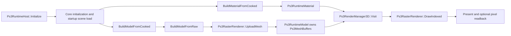

# PS3 native shader integration seams

Historical pre-implementation source survey. See [acceptance-checkpoint-20260924.md](acceptance-checkpoint-20260924.md) for the implemented and validated state; preserve the proposals below as design provenance, not current missing-work claims.

Status: partial source survey for the next backend/cooker plan. This pass did not build, run tests, launch RPCS3, or take screenshots. Facts below come from the checked-in native sources and current scripts; suggested attachment points are proposals, not an implementation decision.

## Current cooked asset to draw path



- `Ps3RuntimeHost::Initialize` constructs the 3D/2D managers and `Ps3ContentStreamSource`, gives the source to Core initialization options, then loads the generated startup scene when one is present (`src/platform/ps3/Ps3RuntimeHost.cpp:142-158, 193-210`). The scene catalog and startup ID come from the generated `ps3_runtime_scene_catalog` interface (`Ps3SceneBootstrap.cpp:17-36`).
- Cooked material loading opens a content-relative stream, calls `AssetSerializer::Deserialize`, casts to `PlatformMaterialAsset`, then constructs `Ps3RuntimeMaterial` with base RGBA and `Lit` (`Ps3RenderManager3D.cpp:442-471, 492-508`; `Ps3RuntimeAssets.hpp:13-43`). The asset's `RendererFamilyId` is logged, but is not retained in the runtime material (`Ps3RenderManager3D.cpp:446-460`).
- Cooked model loading deserializes `ModelAsset`, then calls `BuildModelFromRaw`. That code copies positions, usable normals and 16- or 32-bit indices into native arrays, calls `UploadMesh`, and adopts the resulting `Ps3MeshBuffers` (`Ps3RenderManager3D.cpp:358-439, 474-490`; `Ps3RuntimeAssets.cpp:37-47`). The comment at lines 475-477 says geometry is deferred, but the current executable path below it does build geometry.
- Core's `Draw` reaches `Ps3RenderManager3D::Draw`, which prepares camera/light state and visits the ordered queue. `Visit` combines world and view-projection transforms, selects the first runtime material, then calls `DrawIndexed` with matrices, material color and lighting (`Ps3RenderManager3D.cpp:144-155, 254-292, 294-356`). `Ps3BootHost` calls Core update/draw and then presents the frame (`Ps3BootHost.cpp:195-224`). When a startup scene is active, the diagnostic cube stands down (`Ps3BootHost.cpp:176-194`).

## Shader pair and program identity seam

Current evidence:

- `Ps3RasterRenderer.cpp` includes generated `unlit_vpo.h` and `unlit_fpo.h`; `Initialize` treats them as one fixed vertex/fragment program pair and reflects their parameters (`Ps3RasterRenderer.cpp:13-16, 49-104`). The renderer owns the program pointers, reflected constants/attributes, and an RSX-local copy of fragment microcode (`Ps3RasterRenderer.hpp:123-175`). The pair source is `shaders/unlit.vcg` plus `shaders/unlit.fcg`; the build emits `.vpo`/`.fpo` and generated headers (`docs/Build.md:118-134`). Generated outputs are build products, not runtime extension points.
- A material has a useful existing routing input, `PlatformMaterialAsset::RendererFamilyId`, but `BuildMaterialFromCooked` currently logs and discards it. `Ps3RuntimeMaterial` has only base RGBA and `Lit`; `DrawIndexed` receives no program identity (`Ps3RenderManager3D.cpp:446-460`; `Ps3RuntimeAssets.hpp:19-43`; `Ps3RasterRenderer.hpp:79-92`).
- `Ps3ContentStreamSource` opens arbitrary files below `/app_home/USRDIR/content/` (`Ps3ContentStreamSource.cpp:14, 27-52, 87-95`). In Core mode, `scripts/build.ps1 -ContentRoot ...` recursively stages files into `USRDIR\content`; that option is rejected outside Core mode (`scripts/build.ps1:17-34, 178-181, 304-324`).

Candidate native-only attachment points: keep a versioned PS3 shader-pair sidecar in staged content; retain the chosen program key/version in `Ps3RuntimeMaterial` while building it from the cooked material; have the raster backend load/cache the pair and its reflection state, and select it for a draw. This uses the existing content stream and native subclass/backend without changing generated Core or shared asset output. The concrete sidecar schema, selection rule, and whether the ID is an explicit cooker field or a native mapping from renderer family remain undecided.

## Current RSX input contract

`shaders/unlit.vcg` declares the current vertex semantics and constants (`shaders/unlit.vcg:3-17`). Renderer reflection uses hardware attribute indices for `POSITION`, `NORMAL`, and `COLOR0`; it checks that they exist but does not validate their reflected type/layout (`Ps3RasterRenderer.cpp:156-183`). Each draw binds this fixed native layout (`Ps3Vertex.hpp:6-22`; `Ps3RasterRenderer.cpp:279-304`):

| Input | Current native layout / upload |
|---|---|
| `POSITION` | 3 × F32 at byte 0; stride 40 bytes. |
| `NORMAL` | 3 × F32 at byte 12; stride 40 bytes. |
| `COLOR0` | 4 × F32 at byte 24; stride 40 bytes. |
| UV | No field or binding in `Ps3Vertex`; model upload does not copy UVs. |
| `mvp` | Required reflected vertex constant; `PARAM_FLOAT4x4`, count 4. Core matrix is converted by `ToRowMajor`; the resulting 16 row-major floats are passed as-is to `rsxSetVertexProgramParameter` (`Ps3RasterRenderer.cpp:68-78, 185-187`; `Ps3RenderManager3D.cpp:38-63`). |
| `normalTransform` | Inverse-transpose world matrix for lit draws. |
| `materialColor`, `ambientLight`, `directionalLight`, `directionalDirection` | Four floats each, uploaded as vertex program parameters. |
| `lit` | One float, 1.0 or 0.0. |
| Fragment sampler | None in the current fragment shader (`shaders/unlit.fcg:1-3`); no sampler reflection, texture binding, or texture upload exists in `DrawIndexed` (`Ps3RasterRenderer.cpp:267-307`). |

`Initialize` requires non-null reflections for the six lighting/material constants, but only validates the type/count of `mvp`; the other constants' declared float widths are not checked (`Ps3RasterRenderer.cpp:68-95`). `DrawIndexed` uploads the six values on every submitted draw (`Ps3RasterRenderer.cpp:283-292`). An HLSL runtime path therefore needs reflected binding validation for each program and a sampler/UV path; the exact texture/sampler SDK calls were not established in this source-only pass.

## Texture fixture and resource ownership

- No native image decoder or RSX texture binding was found in the inspected PS3 renderer sources. `Ps3RenderManager2D::BuildTextureFromCooked` ignores the path/source and returns an empty `RuntimeTexture`; its raw overload copies only width/height (`Ps3RenderManager2D.cpp:55-75`). The 3D runtime material has no texture field (`Ps3RuntimeAssets.hpp:19-43`).
- Minimum fixture proposal: a tiny non-uniform RGBA8 checker payload with explicit dimensions/format, staged under `ContentRoot`, plus a material/program selection that samples it. Raw RGBA avoids introducing an image decoder for the first end-to-end proof. It still requires native UV storage/fetch, content-byte parsing, RSX texture allocation/upload/binding, and a fragment sampler. This fixture and format are not present yet.
- Current mesh ownership is incomplete as a lifecycle contract: `Ps3RuntimeModel::AdoptBuffers` stores the buffer descriptor, `Ps3RasterRenderer::ReleaseMesh` exists, but a source search found no call site; `Ps3RenderManager3D::Dispose` only logs counters (`Ps3RuntimeAssets.cpp:37-39`; `Ps3RasterRenderer.cpp:257-265`; `Ps3RenderManager3D.cpp:510-512`). The renderer's own buffers/microcode are released in `Shutdown` (`Ps3RasterRenderer.cpp:309-329`). `Ps3BootHost` shuts down Core, drains the video queue, then shuts down the renderer (`Ps3BootHost.cpp:234-265`); dynamic mesh, shader-pair, and texture resource release must respect the GPU-drain requirement documented on `ReleaseMesh` (`Ps3RasterRenderer.hpp:74-77`).

## Existing build, run and probe commands

The following are the current script interfaces assembled for a `cube_test` Core build. Replace the two roots with the matching generated Core tree and cooked content from the standard platform build; the native repository does not contain a concrete invocation with those generated paths. These commands were not run in this survey.

```powershell
$builds = 'C:\dev\helworks\builds\helengine-ps3'
powershell -NoProfile -ExecutionPolicy Bypass -File scripts/build.ps1 `
  -BuildId ps3-hlsl-cube-test-01 -Mode Core -RunSeconds 12 `
  -GeneratedCoreRoot '<generated-core-root>' -ContentRoot '<cooked-content-root>' `
  -OutputRoot $builds

powershell -NoProfile -ExecutionPolicy Bypass -File scripts/launch_in_emulator.ps1 `
  -ArtifactPath "$builds\ps3-hlsl-cube-test-01\helengine_ps3.self" `
  -OutputRoot $builds -Visible

powershell -NoProfile -ExecutionPolicy Bypass -File scripts/tests/ps3-runtime-visible-content.tests.ps1 `
  -TtyLogPath "$builds\ps3-hlsl-cube-test-01\emulator-runs\<UTC>\TTY.log"
```

`Core` plus `GeneratedCoreRoot` enables Core and `ContentRoot`; the generated scene catalog provides the startup ID, and the visible-content test expects that ID to be `cube_test` (`scripts/build.ps1:21-33, 178-199`; `Ps3SceneBootstrap.cpp:17-36`; `scripts/tests/ps3-runtime-visible-content.tests.ps1:17-31`). Use `-Visible`: the launcher enables color-buffer write-back and captures per-run `TTY.log`/`RPCS3.log`, whereas headless RPCS3 uses the Null renderer (`scripts/launch_in_emulator.ps1:93-147`; `docs/Build.md:142-152`).

Evidence available without screenshots:

- Runtime TTY markers include scene loaded, material/model realization, mesh upload, visited/submitted drawables, frame counts, and renderer errors (`Ps3RuntimeHost.cpp:193-210, 250-261`; `Ps3RenderManager3D.cpp:132, 446-489, 289-290, 313-317`; `Ps3RasterRenderer.cpp:147-152, 253`). The versioned `helengine_ps3_core_probe` memory snapshot records lifecycle/frame/draw counts, not shader identity or pixel values (`Ps3RuntimeHost.hpp:46-96`).
- `Ps3BootHost::LogFrameProbe` reads six points from the most recently displayed buffer and logs `PS3_FRAME_PROBE`; `Ps3Video::ReadDisplayedPixel` documents X8R8G8B8 readback and warns that stale values are inconclusive if the emulator does not mirror color output (`Ps3BootHost.cpp:30-50`; `Ps3Video.hpp:91-96`). The launcher sets the RPCS3 write-back option for this probe (`scripts/launch_in_emulator.ps1:99-112`).
- `ps3-runtime-visible-content.tests.ps1` checks `cube_test` loaded and that first-frame center differs from corner. It proves visible centered geometry when readback is valid, but does not yet assert expected HLSL program identity, material color, transform, lighting, or sampler output (`scripts/tests/ps3-runtime-visible-content.tests.ps1:17-31`). `ps3-rendering-contract.tests.ps1` is source-pattern coverage for the current native lighting path, not an HLSL runtime test (`scripts/tests/ps3-rendering-contract.tests.ps1:24-51`).

User visual feedback is not required for objective runtime smoke acceptance: a successful visible RPCS3 run, logs, and deterministic expected pixel assertions can establish rendering without screenshots. Human inspection remains useful for visual quality, but the existing center/corner assertion is too weak to replace pixel expectations for the new shader/material/texture behavior.

## Open items for the backend/cooker contract

- Define the versioned shader-pair payload, renderer/program identity, and cooker-to-runtime selection rule.
- Decide the reflected binding contract, including which constants are required or optional and how unsupported HLSL resources fail.
- Verify texture/sampler formats, SDK calls, alignment, and ownership inside the pinned Docker SDK image; do not infer them from host SDK availability.
- Add a native disposal path for per-model RSX buffers and define when dynamic program/texture resources are released relative to `video.Drain()`.
- Produce the concrete generated/content roots and expected pixel values for the `cube_test` HLSL build. Current command syntax is known; those inputs and this pass's runtime results are not.

Index note: the codebase-memory index was ready for `C-dev-helworks-helengine-ps3`; the checked native paths had no recorded parse issues and were read directly. `scripts/tests/build-contract.tests.ps1` is marked partially parsed (lines 281-322), so no claim here relies on graph parsing of that script.
